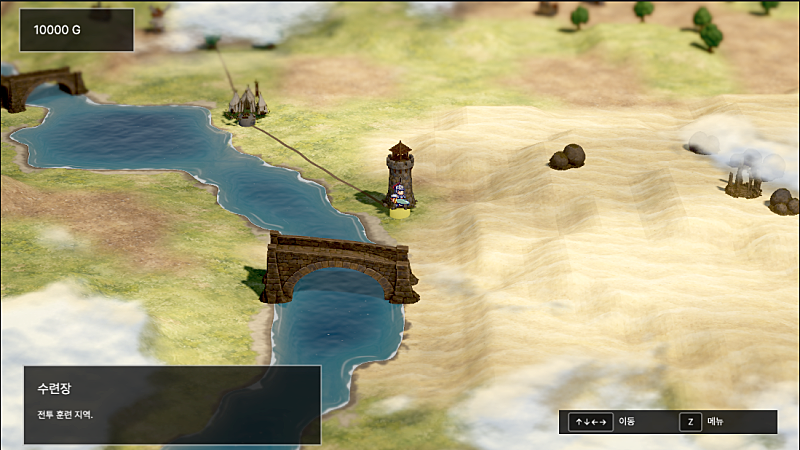
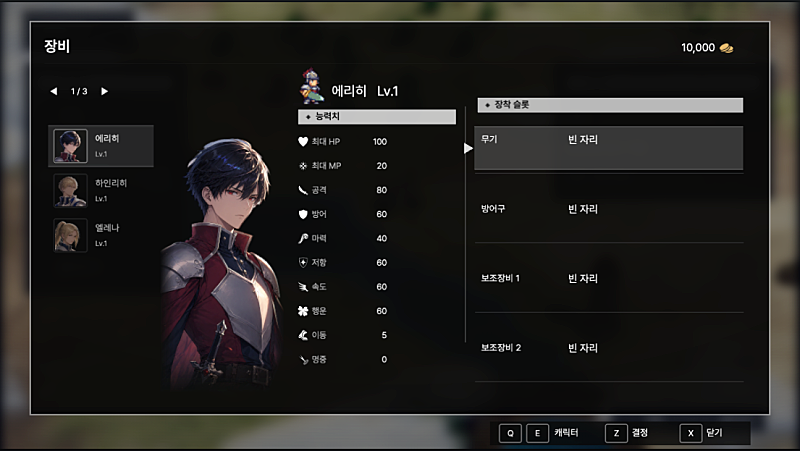
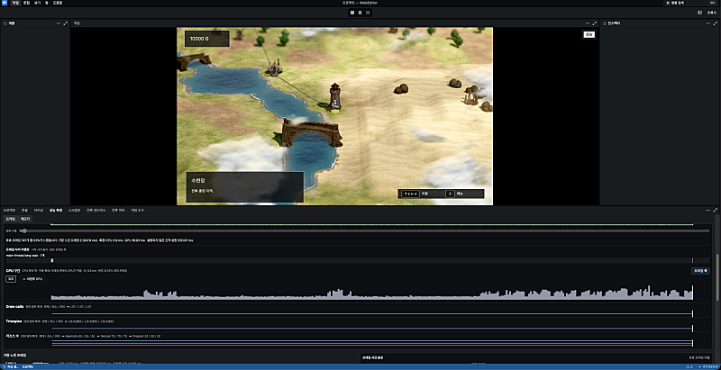
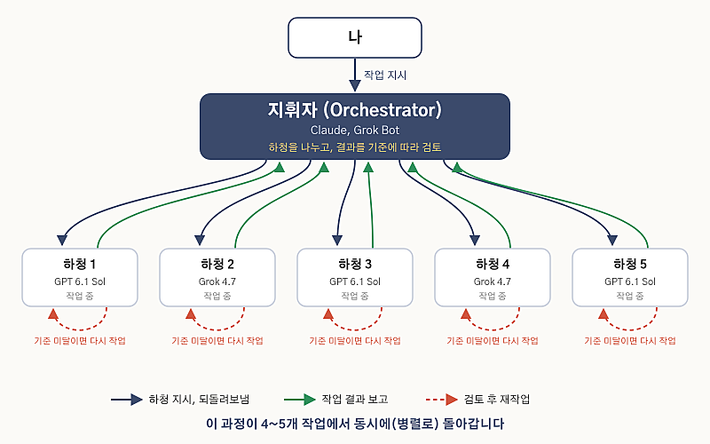

Last time I lightly went over what I thought of the AI models, and my workflow. Right now I'm using Claude, Codex, and Cursor, all of them. Claude Opus 5.5 came out at an economical price, and I'm really grateful.

## SRPG, lately

Screenshots of the SRPG I was building.

I've left Unity entirely and I'm building my own engine.

Building the engine has pushed the game itself to the back for a while. I'm spending time and tokens on it, and the results coming out are satisfying. I'm getting the thing I wanted since college: building my own engine.

## After vibe coding

The first time you build with AI, click-click and it comes out, and it's surprising. Like the phrase vibe coding says, you get excited and start dancing.

Get interested in AI and study it, and you start seeing terms like these.

- Prompt engineering
- Context engineering
- Harness engineering
- Graph engineering

Lately I also hear the phrase software factory.

I don't really like these terms. They put a name, late, on things people were already doing, and I think more people meet them with the point already bent out of shape. Just say "do it" and it does everything, so why study? Then you use it and find out that's not how it goes.

In the end, the reason these things exist is: how do you make an agent better at the work? And that connects to: how do you get the agent to produce output you can trust?

Just ask and it does fine. But in the end you have to get your intent across in words, and that's a pain. If the model is good, it'll put out a good result and just get what you meant. Keep using it, though, and you hit the limit. One of the skills for getting intent across is something like mattpocock's grill-me.

If it isn't given tools it can use, or results it can observe, an agent can't carry the work out accurately. It gives you a plausible answer, and picking the conclusion is still on the person. This is where people usually reach for MCP or a CLI. Before the official Unity CLI existed, I built a unity cli and used that. These days I even use Computer Use. The tokens feel wasted, of course.

And sometimes the project needs its own process, or its own intent. If that information isn't in the code, no matter how good the model is, it fumbles and wastes effort. Or it is in the code, and finding it still burns time and tokens for no good reason. A harness that holds this information is better. Inside the project, I save planning docs, plan docs, and skills as files.

## Cutting down how much a person steps in

Lately it's gone past that, into how do you minimize the person stepping in. Services like Grok Bot, Meta muse, and dots showed up recently. They stress handling the work 24/7 in place of a person. Past development, they also cut how much you step into the management side. When a user question or a bug report comes in, Grok Bot can handle it instead. I use Grok Bot a lot too. Worth looking up if you're interested. It's been helping me write this post.

Meanwhile the agent handles dozens of issues with no input from me. I check the results about twice, I think. Even like that, what comes out is very satisfying.

This works because I told the agent the bar. What the output has to be. There's a plugin called pstack, from Lauren Tan at Cursor. I learned a lot from looking at it. Fine to use as is, and I think it's also worth studying and then changing it for yourself. There are a lot of interview videos on YouTube with this person's thinking in them. Worth a look if you're interested.

1. When I give work to Claude or Grok Bot, they become the orchestrator.
2. They subcontract it to kids like GPT 6.1 Sol or Grok 4.7.
3. When a subcontractor finishes, it reports back to the orchestrator.
4. The orchestrator reviews against the bar, and if it doesn't meet it, sends it back.
5. The subcontractor works it again.
6. And this runs in parallel, about 4 or 5 at the same time. In a cloud setup like Cursor Cloud, you could run more.

Work goes on like this for a few hours. I also end up making several projects. Games, tools, systems, that kind of thing. It's gotten to where I don't have to put much time in. I check the results on a phone or an iPad.

Building this kind of system is more fun than making the game.
