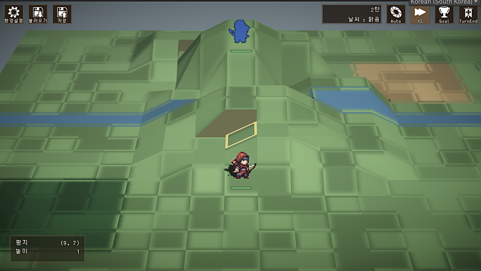
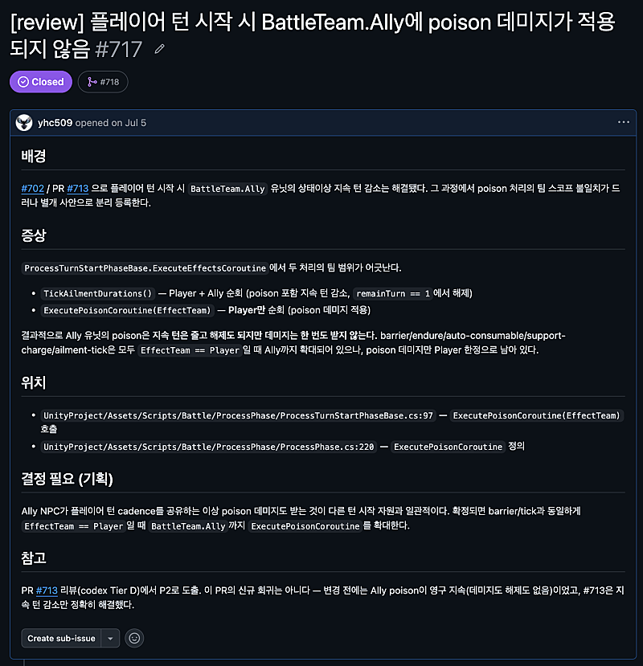

I'm doodling an SRPG with Claude Code.

These days I'm starting to care a bit about visuals and art. The terrain is temp assets. The unit pixel art, I draw myself.

Game development has a lot of fields. Programming, planning, scenario, art, sound, and so on. Today I'm only writing about programming.

I leave 99% of the code to AI. What I do is set up an environment the AI can run well in (the harness), plus the occasional code review.

I've used a bunch of models. Quick notes on the models and the plans.

## Claude ($20, $100): Claude Code

There's a lot of noise about pricing lately, but it still feels like the safest one. I mostly use Opus-class. Fable seems to be what I reach for when designing or writing. It's the best at just reading what I want and handling it, so using it is comfortable. Debugging and bug tracing, though, it talks a lot of nonsense, and that gets frustrating.

$20 is nowhere near enough. $100 seems like enough for hobby use.

Right now I'm trying Grok as the main one, so Claude is just for reviewing scenarios Gemini wrote.

## GPT ($200): Codex

In AI coding right now it's the other mountain next to Claude, and each has its own ups and downs. GPT tends to do only what you told it, but it feels thorough. Like tapping every stone on the bridge before crossing. For someone who can prompt with a fine touch, it might be the better AI.

On the $200 plan I used it like crazy. Ran several in parallel and even filled the weekly 100%.

There's a rumor a model called Astra is coming soon. Curious how that'll be.

## Gemini ($20): Antigravity

Gemini is what led me into AI coding last year, and honestly, it's not great.

Seems better for writing than for coding. I use it when working out scenario and story.

3.8 Flash came out today. Lately it's been Flash after Flash, and that direction is a shame.

## Grok ($100): Grok Build

Grok 4.6 came out and I've been using it since last month. Honestly, next to Claude and GPT it's one weight class down. The work I do isn't that hard, though, so it's surprisingly usable. I think it needs some harness setup.

Unlike Claude or Codex, there's only week usage. And $100 is nowhere near enough. They hype Grok 4.6 as cheap, but in Long Context the usage burn is huge. For coding or long jobs, it's really not good.

This month I'm thinking of ending the Grok subscription and moving over to Cursor. Trying different models and harnesses seems like a good experience too.

When people around me start with AI development, I tend to recommend Claude. Especially to non-majors. That it just figures out what you want seems to matter.

## Workflow

### Planning, design

I design before I start the work. I go back and forth with the AI as much as I can, stacking context as I go. Skills in the Socratic, interview style, like brainstorming and grill-me, work better. I think of it as lining up the AI's thinking with mine. I took ideas from several of those skills and made my own, and that's what I use.

I check across several documents whether my intent got across. Take a look at Spec-Driven-Development.

When it feels done, I don't jump straight into the work. I file an issue first.

### Issue tracking

Git and GitHub, obviously. I recommend actually learning Git.

I use GitHub Issues and Pull Requests to manage tasks and milestones. New features, bugs I find, those go in as Issues. A bug found mid-task gets its own issue and I deal with it later.

Before opening a PR I run an AI code review. Depending on whether the comments can be bundled, I either include them or file a separate Issue. I'll write about code review another time.

AI files every Issue. I don't write them myself. Say "do it" and it does the whole thing. Sometimes the description comes out thin, but there are already plenty of skills for that, so installing them helps.

New work is keyed off the Issue number. "Let's do issue 717" and it goes and reads the code and grabs the context.

I always tell people around me to manage projects with GitHub Issues. It doesn't actually have to be GitHub Issues. What matters is that the work is tracked as tasks and issues, and that the AI can reach them. Scribble it in a notepad by yourself and it's hard to hand to the AI, and your head gets messy too.
