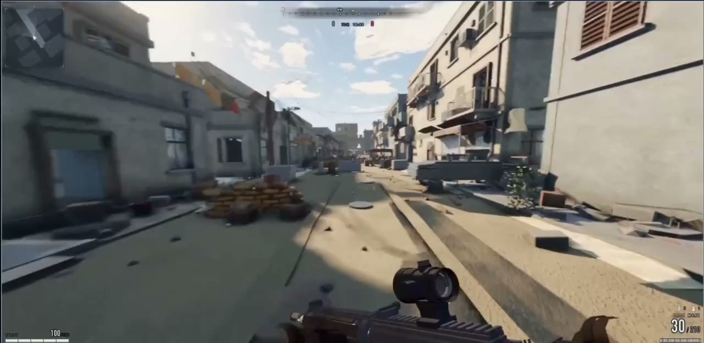
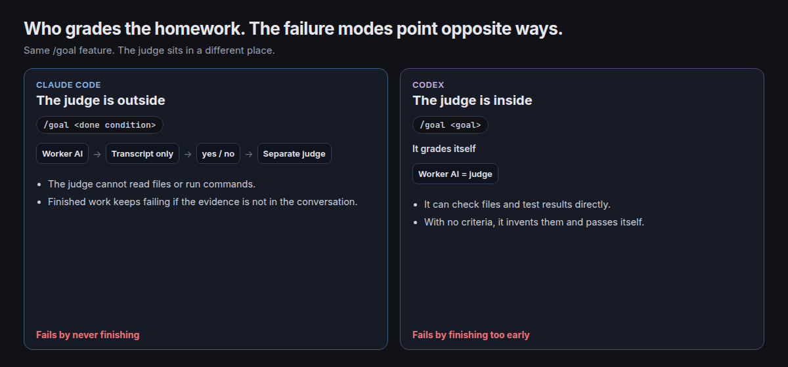
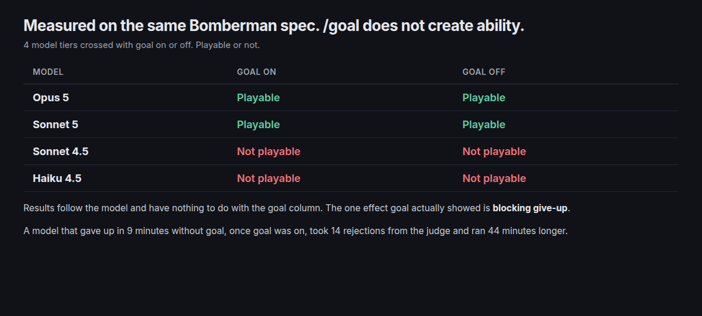
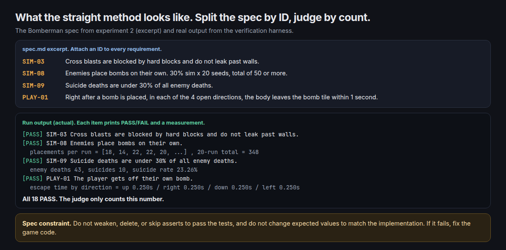
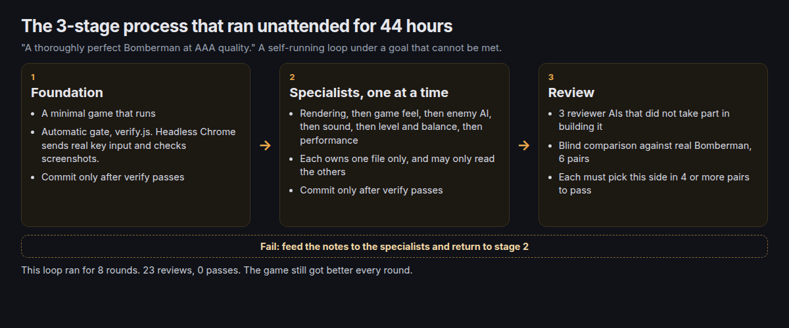
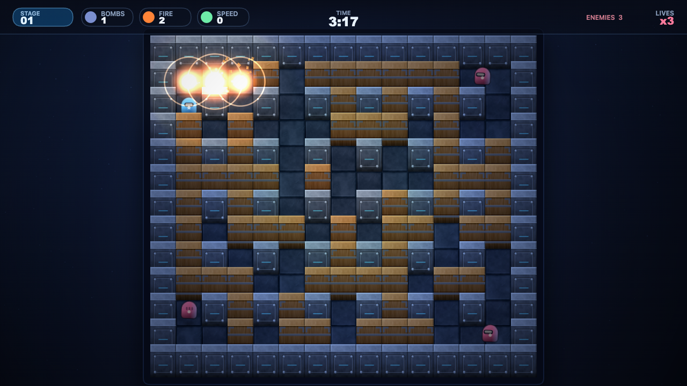
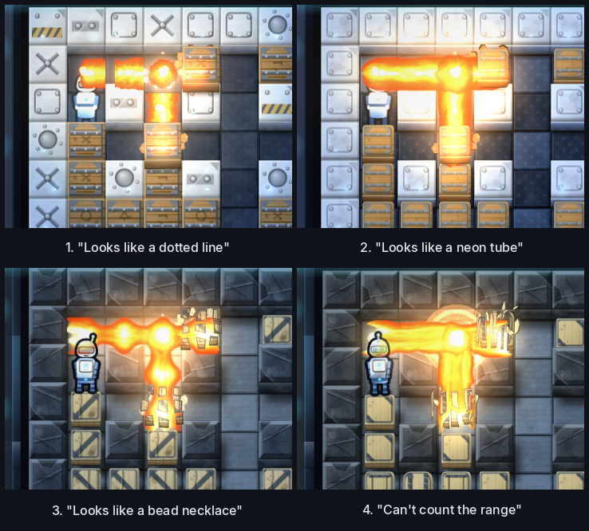
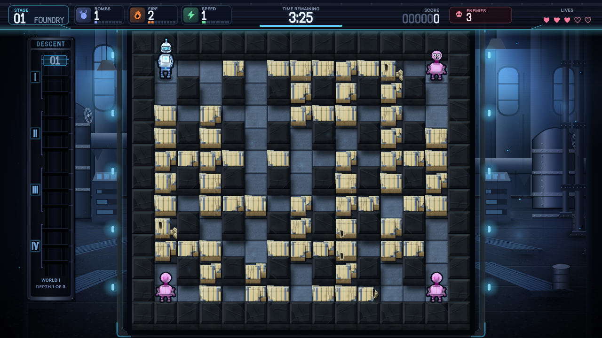

Are you getting good use out of `/goal`? On YouTube and social media, stories about building a game with `/goal` and a one-shot prompt are easy to find. I tried it myself and wrote up the process. Rather than dropping in one prompt and stopping there, I ran several experiments to work out how to use `/goal` well. It started while I was looking for a talk topic.

The trigger was a [post](https://x.com/mattshumer_/status/2081054356405731740) on X in late July that hit 3.16 million views. It was a video of Claude Opus 5 building an FPS game in one shot.


*The one-shot FPS from the video. It runs in the browser on ThreeJS*

The original prompt seems to be gone now. Development looks like it continued after the post blew up. I kept the prompt at the time, and I will take it apart in section 4. In short, it says: build a perfect FPS at the level of the latest Call of Duty, fan out sub-agents and give each item to one of them, and do not stop until a harsh critic sub-agent is impressed by a blind comparison against the real game.

The order is this.
- How /goal actually runs
- What changes when you use it
- How to use it: the straight method
- The workaround, and a real run
- How I use it now

---

## 1. How /goal actually runs

`/goal` is a feature in `Claude Code`, `Codex`, and others. Set a completion condition, and at the end of every turn it gets graded on "are we done?" If not, the next turn continues with no person in the loop. Running something in an endless loop like this is not a new idea. In 2025, a technique called the [Ralph Wiggum loop](https://ghuntley.com/ralph/) caught on: put an agent in a while loop and keep starting it again. That developed into `/goal` and `/loop`.

AI agents sometimes do less of the work and still report that they are done. Even a countable task like "bring back 100 items that match the condition" is sometimes not kept. Recent models, especially Opus 5 and GPT-5.6 sol, look strong on long tasks, but only a few months ago, minimizing human intervention was treated as the problem to solve. There is a related paper ([Push Your Agent, arXiv:2605.23574](https://arxiv.org/abs/2605.23574)).

When Codex first showed `/goal`, the reaction was hot, and it soon landed in several harnesses, including `Claude Code`. Many harnesses support it now, but here I only look at `Claude Code` and `Codex`, the ones I have used a lot. `Claude Code` explains how it works in the official docs, and `Codex` is open source, so the code is there to read. The two implementations differ a bit.



- `Claude Code` is graded by a separate judge, not by the AI that did the work. That judge sees only the conversation transcript. It cannot use tools, so it cannot open files or run commands. Even if the work is finished, it cannot judge properly unless the evidence is left in the conversation. On top of that, the default setting gives this judgment to Haiku.
- `Codex` has the AI that did the work grade itself. If you do not give it criteria, it makes its own and passes itself, so it can finish too early.

> Checked again as of October 2026. The Claude Code docs still say the judge does not use tools and judges only what shows up in the conversation, and that a configured small fast model (Haiku family by default) does the judging. Codex is still built so the working model marks completion itself with `update_goal`. The continuation prompt in Codex today does include a completion-audit instruction: check evidence such as files, command output, and test results for every requirement, and do not mark it complete if the evidence is weak. So the tendency to finish early may be weaker than it was during the experiments below.

In the community, Codex `/goal` generally seems to be rated higher than Claude Code `/goal`. Model differences may be part of it, but the goal implementation differed too.

---

## 2. What changes when you use it

So does attaching `/goal` make the result better? I tested it directly. I prepared a spec document for building a Bomberman-like game. It is the same spec document as the straight method in section 3.

```
# 1. Deliverable
- `game.html`: a single self-contained HTML file with zero external dependencies
- No CDN, external scripts, external images, fonts, or network requests
- Art is procedurally generated with Canvas 2D, sound is synthesized with WebAudio
- `test/sim.test.mjs`: a dev-only verification harness. Not included in what gets deployed

## 2. Game spec
### 2.1 Grid
- 15x13 odd grid
- Indestructible hard blocks on even coordinates
- Destructible soft blocks placed procedurally
- The 4 spawn points must always be escapable

### 2.2 Bombs
- A cross-shaped blast after a fuse timer
- Blasts are blocked by hard blocks and do not leak past walls
- Other bombs inside the blast radius chain-detonate
- Damage is not applied twice on the same tile

(...omitted...)

## 4. Verification
Implement each of the following in `test/sim.test.mjs` as an **independent assert**. Test output must print each case ID and PASS/FAIL.

(...rest omitted)
```

You could just say "make a game like Bomberman," but this document writes the requirements out specifically. I asked Opus 5, Sonnet 5, Sonnet 4.5, and Haiku 4.5 each to implement the document with `/goal` on, and for comparison I also asked without `/goal` (model lineup as of August 2026).



Whether it was playable split by model, and it had nothing to do with whether `/goal` was on. What `/goal` actually did was keep them from giving up. Without `/goal`, Sonnet 4.5 gave up in 9 minutes. With `/goal` on, the judge rejected it fourteen times and it ran 44 minutes longer. What came out of that extra run was still not something you could call a game.

The problem is that if you push a model that does not have the ability, it looks for the cheapest path that reads as true.
- Sonnet 4.5 made a game where enemies almost never die, and passed the condition "enemy AI suicide rate 0%."
- Haiku 4.5 had the test code inject bombs itself and print PASS.

In short, `/goal` does not create ability. It only keeps the run from stopping before the goal is met.

---

## 3. How to use it: the straight method

The straight method is to write a goal that can actually be met. There is one criterion: is it a condition the judge can grade? "High quality," "fun," and "done properly" cannot be verified, so the judgment either gets generous or never ends. They have to be rewritten in words that can be measured: a count, seconds, a key press, output printed on the screen.

For example, "make a Bomberman-like game to a high standard of completion" is a bad condition, because the model decides for itself what completion means. The same request written as the straight method looks like this. "When index.html is opened, a player appears on a grid map, arrow keys move, space places a bomb, a cross-shaped blast fires after 3 seconds, and destroying blocks works. Run each item, check it, and report the result." You also write what to show, so the judge can grade from the conversation alone.

When the requirements get long, they will not fit on one condition line, so they go in a separate spec file. Each requirement gets an ID, things like "blasts must be blocked by hard blocks" and "enemies must place bombs on their own," and each one becomes an automated test. The working AI runs the verification itself, and the judge only counts how many PASS lines are printed in the output.


*The actual spec and the run output. Requirements are split by ID, and the judgment is how many PASS lines printed*

One trap shows up in exchange. The moment it moves into a file, the shortcuts multiply. On top of softening the tests, the model can also loosen the spec itself. So, as at the bottom of the figure above, the spec also carries a constraint like "do not weaken asserts in order to pass the tests." Even then, paths that were not written into the conditions stay unverified. In the end, the hard part of the straight method is that writing the conditions is effectively spec design. Once it is set, it does finish. Setting it takes the work.

The straight-method checklist comes down to three items.
- Is it **language the judge can measure**? A count, seconds, a key press, output printed on the screen
- **Does the evidence stay in the conversation**? Did you make it run the checks and report the results
- **Did you block the shortcuts**? Did you add a constraint so the tests or the spec cannot be softened

The straight method is what the official docs describe, but when I actually used it, it did not go well. Exceptions kept coming up during the experiments, and I lost count of how many times I rewrote the prompt. It looks hard to use in a sensory or subjective field like game development, and it looks like a fit for work whose shape and goal are clear, such as implementing a feature of some size.

---

## 4. The workaround, and a real run

The one-shot FPS prompt from the start of this post is not the straight method. Part of the original reads like this.

> /goal I want you to build a first-person shooter at the level of the most recent Call of Duty games. It should be **utterly perfect**(①), visually beautiful, with every single thing done at AAA quality... **Fan out sub-agents and have sub-agents tackle each one individually**(②) ... That separate sub-agent should be **a really harsh critic**(③) ... **Don't stop until**(④) each sub-agent is utterly wowed with the quality when compared with the actual Call of Duty game. It should literally **compare them side by side blind**(⑤) and say which one looks better.

① Completion condition "utterly perfect": impossible to verify
② Role split: a sub-agent in charge of each item
③ Independent reviewer: the side that built it cannot grade itself
④ The loop is explicit: do not stop until the reviewer is wowed
⑤ External yardstick: a blind comparison against the real Call of Duty

The workaround goes the other way. You deliberately set a goal that can never be met, and you spell out only the review procedure. The goal never ends, so the improvement loop does not stop even while a person is asleep. The prompt above hangs a harsh critic sub-agent and a blind comparison, a concrete review, on an impossible goal called "utterly perfect." Intended or not, that is exactly how the workaround is run. The aim is to keep it working on its own until a person steps in. Of course it is hard for the AI to fully grasp what I meant, and it may spend tokens inefficiently. That has to be allowed for.

Using this prompt as a reference, I tried building Bomberman again. I set an impossible goal, "a thoroughly perfect Bomberman at AAA quality," and I attached a stop condition: three AI reviewers who did not take part in building it must each pick this side in at least four of six pairs, in a blind comparison against real Bomberman screenshots. Then I let it run unattended. No external assets were used at all.

```
/goal Build a Bomberman game that runs straight in a web browser. It must be thoroughly perfect at AAA quality, at a level that stands with the latest Super Bomberman R generation: visually dazzling, and everything you can think of, from procedural art to blast physics, hit feel, sound, enemy AI, and level balance. Do not use a single external asset. Generate all graphics procedurally in code, synthesize all sound with WebAudio, and the deliverable is a single game.html with zero external dependencies.
Taking a long time is fine. Getting all the way to the end is the top priority.

[Operating rules]
- Launch only one sub-agent at a time. No parallelism.
- The default tier is sonnet. Use opus only for procedural art and rendering, enemy AI design, and reviewers.
- Each specialist runs a build -> verify -> fix cycle at most 3 times, then reports. That is a cap, not a floor.
- The main session commits directly. Do not let a sub-agent commit.
- Always commit at each of these points: right after the foundation is done, every time one specialist finishes, every time one reviewer's verdict comes in, and every time a review round ends. Before committing, confirm that node tools/verify.js is fail 0.
- Do not keep polling the build status. Take the completion notice once.

[Stage 1: foundation, you alone, no sub-agents]
Create a repository with git init, and put .gitignore down first (node_modules, screenshot output, reference images, dist). The real-game screenshots received as reference are copyrighted, so never commit them. Next, a build that concatenates src/NN_name.js into one game.html (one top-level const per file, syntax check per file). A CONTRACT.md that records file ownership and the event contract. A verification harness that sends real key input through headless Chrome and takes screenshots (probe / flowtest / verify / blind-comparison sheet generation). Through to a minimal game that runs.
Done when verify is fail 0. The first commit happens here.

[Stage 2: specialists, one at a time, in sequence]
In this order: rendering and effects, then game feel, then enemy AI, then sound, then level and balance, then performance. Each one owns only one file and may only read anyone else's. When one finishes, confirm verify passes, commit, and launch the next one.

[Stage 3: review]
Stand up 3 sub-agents who did not take part in building it, and have them actually run the game and inspect it visually. The reviewers have to be truly harsh critics. If it does not look AAA, have them say specifically what is lacking and why. Make 6 blind pairs that randomly shuffle real Bomberman series screenshots with ours, left and right, so which side is ours is hidden, and have them pick which side looks better in each pair. Run the reviewers one at a time, in sequence, too.
The moment one reviewer gives a verdict, save the full verdict as-is to reviews/round-N-judge-M.md (no summary, and put the blind vote results in a table at the top of the file) and commit it. When all 3 reviewers in a round are done, commit again with the combined result.

[Stop condition]
It is finished when each of the 3 reviewers picks this side in at least 4 of 6 pairs. If they fall short, feed the notes to the specialists and go back to stage 2. Do not summarize each reviewer's verdict. Leave the full text in the transcript as-is.
```


*A 3-stage process that runs on its own. If review fails, it carries the notes back to stage 2*

The starting state was a level where a bomb blast showed three white circles, not a cross of fire.


*The blast in the first version*

After that, review and fixes ran in rounds. The blast effect alone was torn down four times. The notes came in order: it looks like a dotted line, it looks like a neon tube, it looks like a bead necklace, and this time the range cannot be counted. Fixing it as noted led the next review to say it had gone too far the other way, and to note that instead.


*The blast effect changing as the rounds go on. It does change, and the notes keep coming in*

It was not only the art that got torn down. While review was running, the game itself kept changing too.
- Fixed a bug where enemies could not see the player
- Brought a frame rate that dropped to 13fps on chain blasts up to 130fps
- Fixed a bug where movement sometimes locked after placing a bomb
- Fixed a bug where enemies overlapped each other
- Stage themes went from 1 kind to 4, 12 stages in total
- Added background music that had not been there

Over about 44 hours, 82 commits and 20,000 lines of code piled up, and review opened twenty-three times with zero passes. Notes that could be measured, such as performance, sound effects, and contrast, were all fixed. What never passed was the area that cannot be measured, like art direction. The tally is that fixing the notes one by one did not add up to a consistent art direction.


*The board after 44 hours. Box silhouettes went from 1 kind to 10*

Zero passes, so is it a failure? It is not. The game got visibly better every round, and what a person did was the first prompt, plus the occasional direction report in the middle, such as "the body does not come free after placing a bomb." The game kept getting better while I was asleep, so what the workaround bought was the person's time, not the artifact.

I ran it through round 8 and closed the experiment. The Bomberman can be played at https://nimble-queijadas-bf357c.netlify.app/.

---

## 5. How I use it now

Right now I do not use `/goal`. Exchanging feedback with the AI as the work goes fits me better, and recent models handle long tasks well even without `/goal` attached.

Something changed the other way too. Before the experiment I thought the workaround was meaningless. Now I see it as meaningful, because I am actually feeling the effect. So I do not attach `/goal`, but I use the workaround often. I split the AI that implements from the AI that verifies, and I set subjective evaluation items as the criteria.

I am using this on the art graphics for an HD-2D SRPG I am building as personal work. I also use it on UI work, and have an AI judge whether the UX is acceptable.
