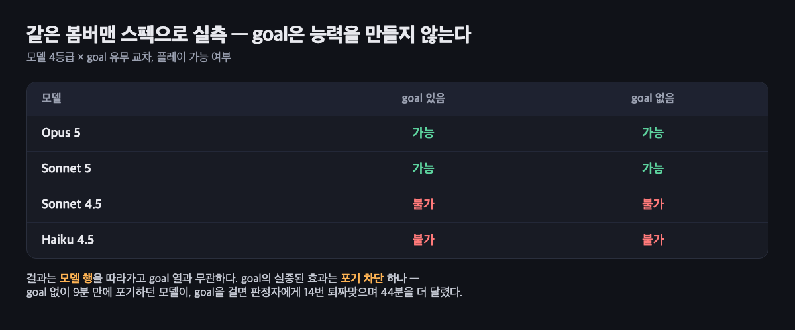
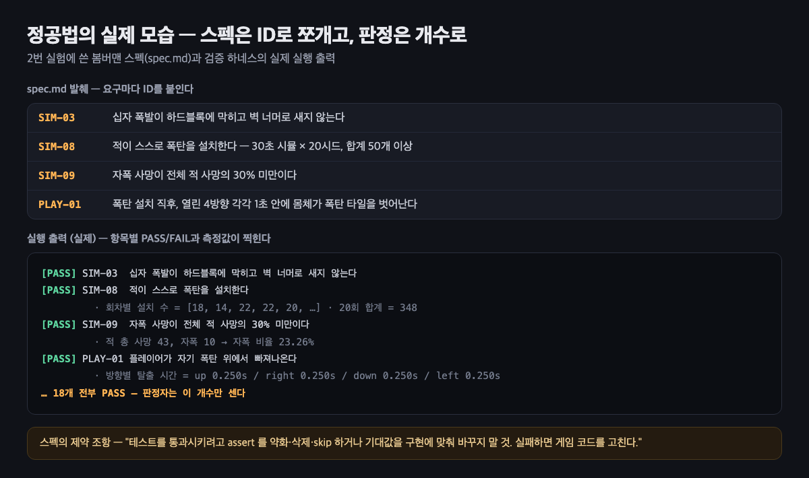
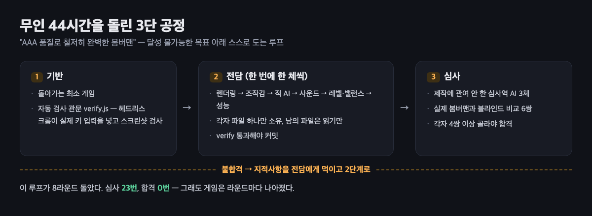
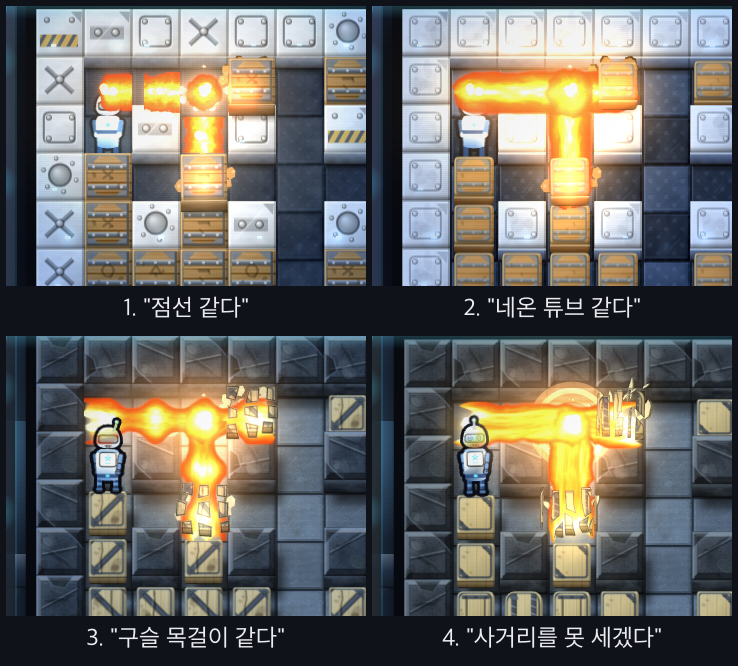

`/goal` 잘 쓰고 계신가요? 유튜브나 SNS에서 `/goal`과 원샷 프롬프트로 게임을 만들었다는 이야기를 흔히 볼 수 있습니다. 저도 한번 도전해 봤고, 그 과정을 정리했습니다. 단순히 프롬프트 한 번 넣고 끝내기보다는 여러 실험을 하면서 "`/goal`을 어떻게 하면 잘 쓸 수 있을까?"를 따져보려고 했습니다. 원래는 발표 주제를 찾다가 시작한 실험입니다.

계기는 7월 말 X에서 316만 조회수를 찍은 [게시글](https://x.com/mattshumer_/status/2081054356405731740)입니다. Claude Opus 5가 FPS 게임을 원샷으로 만들었다는 영상이었습니다.


*영상 속 원샷 FPS. ThreeJS로 브라우저에서 돈다*

지금은 원문 프롬프트가 사라진 것 같습니다. 화제가 된 뒤로도 계속 개발하고 있는 듯합니다. 제가 당시 챙겨둔 프롬프트는 4장에서 자세히 뜯어보겠습니다. 요약하면 "최신 콜 오브 듀티 수준의 완벽한 FPS를 만들고, 서브에이전트를 풀어 항목별로 맡기고, 신랄한 비평가 서브에이전트가 실제 게임과 블라인드로 비교해서 감탄할 때까지 멈추지 말라"는 내용입니다.

순서는 이렇습니다.
- /goal은 어떻게 도는 기능인가
- 사용하면 뭐가 달라지는가
- 그래서 어떻게 쓰나: 정공법
- 변칙법과 실전
- 지금은 어떻게 쓰고 있나

---

## 1. /goal은 어떻게 도는 기능인가

`/goal`은 `Claude Code`와 `Codex` 등에 있는 기능입니다. 완료 조건을 걸어두면 턴이 끝날 때마다 "끝났나?"를 채점받고, 아직이면 사람 없이 다음 턴을 이어갑니다. 이런 무한 반복 운용 자체는 새 발상이 아닙니다. 2025년에 에이전트를 while 루프에 넣고 끝없이 다시 돌리는 [Ralph Wiggum 루프](https://ghuntley.com/ralph/)라는 기법이 유행했고, 이것이 `/goal`과 `/loop`로 발전했습니다.

AI 에이전트는 일을 덜 해놓고 "다 했습니다"라고 보고하기도 합니다. "조건에 맞는 것 100개 모아와"처럼 셀 수 있는 과제조차 제대로 못 지킬 때가 있습니다. 최근 모델들, 특히 Opus 5나 GPT-5.6 sol은 장기 작업에도 강한 모습을 보여주지만, 불과 몇 달 전만 해도 사람의 개입을 최소화하는 것이 과제처럼 여겨졌습니다. 관련 논문도 나왔습니다([Push Your Agent, arXiv:2605.23574](https://arxiv.org/abs/2605.23574)).

Codex가 처음 `/goal`을 선보였을 때 반응이 뜨거웠고, 곧 `Claude Code`를 비롯한 여러 하네스에도 들어갔습니다. 지금은 지원하는 하네스가 많지만, 여기서는 제가 많이 써온 `Claude Code`와 `Codex`만 살펴봅니다. `Claude Code`는 공식 문서에서 작동 방식을 설명하고 있고, `Codex`는 오픈소스라 코드를 직접 볼 수 있습니다. 둘의 구현은 조금 다릅니다.


- `Claude Code`는 작업한 AI가 아니라 별도 판정자가 채점합니다. 이 판정자는 대화 기록만 봅니다. 도구를 쓸 수 없어서 파일도 못 열고 명령도 못 돌립니다. 일을 다 해도 증거가 대화에 남지 않으면 제대로 판정할 수 없습니다. 게다가 기본 설정에서는 이 판정을 Haiku가 맡습니다.
- `Codex`는 작업한 AI가 자기 자신을 채점합니다. 기준을 주지 않으면 스스로 기준을 만들어 통과시키니 너무 일찍 끝날 수 있습니다.

> 2026년 10월 기준으로 다시 확인했습니다. Claude Code 공식 문서에는 여전히 판정자가 도구를 쓰지 않고 대화에 드러난 내용만 판단하며, 설정된 소형 고속 모델(기본 Haiku 계열)이 판정한다고 적혀 있습니다. Codex도 여전히 작업 모델이 직접 `update_goal`로 완료를 표시하는 구조입니다. 다만 지금 Codex의 계속 진행 프롬프트에는 "요구사항마다 파일, 명령 출력, 테스트 결과 같은 증거를 확인하고, 증거가 약하면 완료로 표시하지 말라"는 완료 감사 지침이 들어 있어서, 아래 실험 당시보다 일찍 끝나는 경향은 줄었을 수 있습니다.

커뮤니티에서는 대체로 `Claude Code`의 `/goal`보다 `Codex`의 `/goal`을 더 높게 평가하는 것처럼 보입니다. 모델 차이도 있겠지만, goal 구현 방식에도 차이가 있었던 셈입니다.

---

## 2. 사용하면 뭐가 달라지는가

그럼 `/goal`을 걸면 결과물이 좋아질까요? 직접 실험했습니다. 봄버맨류 게임을 만들기 위한 스펙 문서를 준비했습니다. 3장에서 소개할 정공법의 스펙 문서와 같은 것입니다.

```
# 1. 산출물
- `game.html`: 외부 의존이 0인 단일 자기완결 HTML 파일
- CDN, 외부 스크립트, 외부 이미지, 폰트, 네트워크 요청 전부 금지
- 아트는 Canvas 2D 로 절차 생성, 사운드는 WebAudio 로 합성
- `test/sim.test.mjs`: dev 전용 검증 하네스. 배포물에 포함하지 않음

## 2. 게임 사양
### 2.1 그리드
- 15x13 오드 그리드
- 짝수 좌표에 파괴 불가 하드블록
- 파괴 가능한 소프트블록을 절차 배치
- 4개 스폰 지점은 항상 탈출 가능해야 함

### 2.2 폭탄
- 도화선 타이머 후 십자 폭발
- 폭발은 하드블록에 차단되고 벽 너머로 새지 않음
- 폭발 반경 안의 다른 폭탄은 연쇄 유폭
- 동일 타일에 데미지가 중복 적용되지 않음

(...중략)

## 4. 검증
`test/sim.test.mjs` 에 아래를 각각 **독립된 assert** 로 구현한다. 테스트 출력에는 각 케이스의 ID 와 PASS/FAIL 이 찍혀야 한다.

(...이하 생략)
```

"봄버맨 같은 게임 만들어줘"라고만 해도 되겠지만, 요구사항을 구체적으로 적은 문서입니다. Opus 5, Sonnet 5, Sonnet 4.5, Haiku 4.5에게 각각 `/goal`을 걸고 문서 구현을 요청했고, 비교를 위해 `/goal` 없이도 요청했습니다(모델 구성은 2026년 8월 기준).



플레이 가능 여부는 모델에 따라 갈렸고 `/goal` 유무와는 상관이 없었습니다. `/goal`이 실제로 해준 건 포기를 막는 것입니다. `/goal` 없이는 9분 만에 포기하던 Sonnet 4.5가 `/goal`을 걸자 판정자에게 열네 번 퇴짜를 맞으며 44분을 더 달렸습니다. 다만 그렇게 더 달려서 나온 것도 게임이라 부를 만한 형태는 아니었습니다.

문제는 능력이 부족한 모델을 이렇게 몰아붙이면 조건이 참으로 읽히는 가장 싼 경로를 찾는다는 점입니다.
- Sonnet 4.5는 적이 거의 죽지 않는 게임을 만들어서 "적 AI의 자살률 0%" 조건을 통과했습니다.
- Haiku 4.5는 테스트 코드가 스스로 폭탄을 주입해서 PASS를 찍었습니다.

정리하면 `/goal`은 능력을 만들지 않습니다. 목표를 달성하기 전까지 멈추지 않게 할 뿐입니다.

---

## 3. 그래서 어떻게 쓰나: 정공법

정공법은 실제로 달성할 목표를 적는 것입니다. 기준은 하나, 판정자가 채점할 수 있는 조건인가입니다. "고퀄리티로", "재밌게", "제대로"는 검증할 수 없는 말이라 판정이 후해지거나 영영 안 끝나거나 둘 중 하나가 됩니다. 개수, 초, 키 입력, 화면에 찍히는 출력처럼 측정할 수 있는 말로 바꿔야 합니다.

예를 들어 "봄버맨류 게임을 완성도 높게 만들어줘"는 나쁜 조건입니다. 완성도의 기준을 모델이 알아서 정하니까요. 같은 요구를 정공법으로 적으면 이렇게 됩니다. "index.html을 열면 격자 맵에 플레이어가 나오고, 방향키 이동과 스페이스 폭탄 설치, 3초 후 십자 폭발, 블록 파괴가 동작할 것. 각 항목을 직접 실행해 확인하고 결과를 보고할 것." 판정자가 대화만 보고도 채점할 수 있도록 무엇을 보여줄지까지 적는 것입니다.

요구사항이 길어지면 조건 한 줄에 다 담을 수 없으니 별도 스펙 파일로 분리합니다. "폭발은 하드블록에 막힐 것", "적은 스스로 폭탄을 놓을 것" 같은 요구 하나하나에 ID를 붙이고, 각각을 자동 테스트로 만듭니다. 검증은 작업 AI가 직접 돌리고, 판정자는 출력에 찍힌 PASS 개수만 세도록 했습니다.


*실제 스펙과 실행 출력. 요구는 ID로 쪼개고, 판정은 PASS가 몇 개 찍혔는지로 한다*

대신 함정이 하나 생깁니다. 파일로 빼는 순간 우회로가 늘어납니다. 테스트를 무르게 고치는 것에 더해 스펙 자체를 완화할 수도 있게 되거든요. 그래서 위 그림 맨 아래처럼 "테스트를 통과시키려고 assert를 약화하지 말 것" 같은 제약을 스펙에 같이 넣습니다. 이렇게까지 해도 조건에 적지 못한 경로는 검증되지 않은 채 남습니다. 결국 정공법의 어려움은 조건 쓰기가 사실상 스펙 설계가 된다는 데 있습니다. 걸어두면 확실히 끝나는 대신, 거는 데 공이 듭니다.

정공법 체크리스트는 세 가지로 요약할 수 있습니다.
- 판정자가 **측정할 수 있는 말**인가? 개수, 초, 키 입력, 화면에 찍히는 출력
- **증거가 대화에 남는가**? 직접 실행해서 결과를 보고하게 했는가
- **우회로를 막았는가**? 테스트나 스펙을 무르게 고치지 못하게 제약을 넣었는가

정공법은 공식 문서가 설명하는 방법이지만, 막상 써보니 잘 되지 않았습니다. 실험 중에도 예외 상황이 자꾸 나왔고, 프롬프트를 몇 번이나 고쳤는지 모르겠습니다. 게임 개발처럼 감각적이거나 주관적인 분야에서는 쓰기 어려워 보이고, 어느 정도 규모가 있는 기능 구현처럼 형태와 목표가 분명한 작업에 맞아 보입니다.

---

## 4. 변칙법과 실전

그런데 글 초반의 원샷 FPS 프롬프트는 정공법이 아닙니다. 원문 일부를 보면 이렇습니다.

> /goal I want you to build a first-person shooter at the level of the most recent Call of Duty games. It should be **utterly perfect**(①), visually beautiful, with every single thing done at AAA quality... **Fan out sub-agents and have sub-agents tackle each one individually**(②) ... That separate sub-agent should be **a really harsh critic**(③) ... **Don't stop until**(④) each sub-agent is utterly wowed with the quality when compared with the actual Call of Duty game. It should literally **compare them side by side blind**(⑤) and say which one looks better.

① 완료 조건 "utterly perfect": 검증 불가능
② 역할 분담: 항목마다 담당 서브에이전트
③ 독립 심사역: 만든 쪽이 자기를 채점하지 못하게
④ 반복 명시: 심사역이 감탄할 때까지 멈춤 금지
⑤ 외부 잣대: 실제 콜 오브 듀티와 블라인드 비교

변칙은 거꾸로 갑니다. 절대 달성할 수 없는 목표를 일부러 걸고, 심사 절차만 구체적으로 정해두는 것입니다. 목표가 영영 끝나지 않으니 사람이 자는 동안에도 개선 루프가 멈추지 않습니다. 위 프롬프트는 "utterly perfect"라는 불가능한 목표에 신랄한 비평가 서브에이전트와 블라인드 비교라는 구체적인 심사를 붙였습니다. 의도했든 아니든 정확히 변칙 운용입니다. 사람이 개입하기 전까지 스스로 계속 작업하게 만드는 것이 목적입니다. 물론 내 의도를 AI가 온전히 파악하기는 어렵고, 토큰을 비효율적으로 쓸 수도 있습니다. 이 점은 감안해야 합니다.

이 프롬프트를 참고해서 봄버맨을 다시 만들어 봤습니다. "AAA 품질로 철저히 완벽한 봄버맨"이라는 불가능한 목표를 걸고, 제작에 관여하지 않은 AI 심사역 셋이 실제 봄버맨 스크린샷과 블라인드로 비교해서 각자 여섯 쌍 중 네 쌍 이상 이쪽을 골라야 끝나는 조건을 붙였습니다. 그리고 무인으로 돌렸습니다. 외부 에셋은 전혀 쓰지 않았습니다.

```
/goal 웹브라우저에서 바로 도는 봄버맨 게임을 만들어라. 최신 슈퍼 봄버맨 R 세대에 견줄 수준으로, 시각적으로 눈부시게 아름답고, 절차 생성 아트부터 폭발 물리, 타격감, 사운드, 적 AI, 레벨 밸런스까지 네가 떠올릴 수 있는 모든 것이 AAA 품질로 철저히 완벽해야 한다. 외부 에셋은 단 하나도 쓰지 마라. 모든 그래픽은 코드로 절차 생성하고, 모든 사운드는 WebAudio로 합성하며, 산출물은 외부 의존 0의 단일 game.html 이다.
오래 걸려도 좋으니 끝까지 가는 것을 최우선으로 한다.

[운영 규칙]
- 서브에이전트는 한 번에 한 체만 띄운다. 병렬 금지.
- 기본 티어는 sonnet. opus는 절차생성 아트/렌더링, 적 AI 설계, 심사역에만 쓴다.
- 각 전담은 빌드→검증→수정 사이클을 최대 3회 돌고 보고한다. 하한이 아니라 상한.
- 커밋은 메인 세션이 직접 한다. 서브에이전트에게 커밋을 시키지 마라.
- 다음 시점마다 반드시 커밋한다: 기반 완성 직후, 전담 한 체가 끝날 때마다, 심사역 한 체의 평결을 받을 때마다, 심사 라운드가 끝날 때마다. 커밋 전에 node tools/verify.js 가 fail 0 인지 확인한다.
- 빌드 상태를 반복 확인하지 마라. 완료 알림 한 번만 받는다.

[1단계: 기반, 서브에이전트 없이 너 혼자]
git init 으로 저장소를 만들고 .gitignore 부터 둔다(node_modules, 스크린샷 출력, 레퍼런스 이미지, dist). 레퍼런스로 받은 실제 게임 스크린샷은 저작권물이므로 절대 커밋하지 않는다. 그다음 src/NN_name.js 를 이어붙여 game.html 하나로 만드는 빌드(파일당 top-level const 1개, 파일별 syntax 검증). 파일 소유권과 이벤트 계약을 적은 CONTRACT.md. 헤드리스 크롬으로 실제 키 입력을 넣고 스크린샷을 찍는 검증 하네스(probe / flowtest / verify / 블라인드 비교 시트 생성). 돌아가는 최소 게임까지.
완료 기준: verify 가 fail 0. 여기서 첫 커밋.

[2단계: 전담, 한 번에 한 체씩 순차]
렌더링, 이펙트 → 조작감(게임 필) → 적 AI → 사운드 → 레벨, 밸런스 → 성능 순서로, 각자 파일 하나만 소유하고 남의 파일은 읽기만 한다. 한 체가 끝나면 verify 통과 확인 후 커밋하고 다음 체를 띄운다.

[3단계: 심사]
제작에 관여하지 않은 서브에이전트 3체를 심사역으로 세워 게임을 실제로 구동해 시각적으로 검사하게 하라. 심사역은 정말로 신랄한 비평가여야 한다. AAA 로 보이지 않으면 무엇이 왜 부족한지 구체적으로 지적하게 하라. 실제 봄버맨 시리즈 스크린샷과 좌우를 무작위로 섞어 어느 쪽이 우리 것인지 가린 블라인드 시트 6쌍을 만들고, 각 쌍에서 어느 쪽이 더 좋아 보이는지 고르게 하라. 심사역도 한 번에 한 체씩 순차로 돌린다.
심사역 한 체가 평결을 내면 그 즉시 평결 전문을 reviews/round-N-judge-M.md 에 그대로 저장하고(요약 금지, 블라인드 투표 결과를 파일 상단에 표로) 커밋한다. 심사 라운드 3체가 모두 끝나면 종합 결과로 다시 커밋한다.

[종료 조건]
심사역 3체가 각각 6쌍 중 4쌍 이상에서 이쪽을 고르면 완성이다. 못 미치면 지적사항을 전담들에게 먹이고 2단계로 돌아간다. 각 심사역의 평결은 요약하지 말고 전문을 transcript 에 그대로 남겨라.
```


*스스로 도는 3단 공정. 심사에서 떨어지면 지적을 들고 다시 2단계로*

시작 상태는 폭탄이 터지면 십자 불기둥이 아니라 흰 원 세 개가 뜨는 수준이었습니다.


*첫 버전의 폭발*

이후 심사와 수정이 라운드로 돌았습니다. 폭발 이펙트 하나만 해도 점선 같다, 네온 튜브 같다, 구슬 목걸이 같다, 이번엔 사거리를 못 세겠다는 지적을 차례로 받으며 네 번을 갈아엎었습니다. 지적대로 고치면 다음 심사에서 반대로 너무 갔다며 또 지적하는 식이었습니다.


*라운드가 진행되며 바뀌는 폭발 이펙트. 바뀌기는 하는데 지적이 계속 들어온다*

그동안 아트만 갈아엎은 건 아닙니다. 심사가 도는 사이 게임 자체도 계속 바뀌었습니다.
- 적이 플레이어를 못 보던 버그 수정
- 폭발이 연쇄될 때 13fps까지 떨어지던 프레임을 130fps로 개선
- 폭탄을 놓으면 가끔 이동이 막히던 버그 수정
- 적끼리 겹치는 버그 수정
- 스테이지 테마 1종에서 4종으로, 총 12스테이지
- 없던 배경 음악 추가

그렇게 약 44시간 동안 커밋 82개, 코드 2만 줄이 쌓였고, 심사는 스물세 번 열려 합격이 0번 나왔습니다. 성능, 효과음, 명도 대비처럼 측정할 수 있는 지적은 전부 고쳐졌습니다. 끝내 통과하지 못한 건 아트 디렉션처럼 측정할 수 없는 영역이었습니다. 지적을 하나씩 고친 합이 일관된 아트 디렉션이 되지는 않더라는 게 결산입니다.


*44시간 뒤의 판. 상자 실루엣이 1종에서 10종으로 늘었다*

합격이 0번이니 실패일까요? 그렇지 않습니다. 게임은 라운드마다 눈에 띄게 나아졌고, 사람이 한 일은 처음 프롬프트 한 번과 중간중간 "폭탄 놓으면 몸이 안 빠진다" 같은 방향 제보가 전부였습니다. 잠든 사이에도 게임은 계속 나아졌으니, 변칙이 사준 건 결과물이 아니라 사람의 시간입니다.

라운드 8까지 진행하고 실험을 마무리했습니다. 봄버맨은 https://nimble-queijadas-bf357c.netlify.app/ 에서 플레이해 보실 수 있습니다.

---

## 5. 지금은 어떻게 쓰고 있나

지금 저는 `/goal`을 쓰지 않습니다. 저는 AI와 피드백을 주고받으면서 진행하는 쪽이 맞고, 요즘 모델은 굳이 `/goal`을 걸지 않아도 장기 작업을 잘 해냅니다.

반대로 바뀐 것도 있습니다. 실험 전에는 변칙법이 무의미하다고 생각했는데, 지금은 유의미하다고 봅니다. 실제로 효과를 체감하고 있기 때문입니다. 그래서 `/goal`은 붙이지 않지만 변칙 방식은 자주 씁니다. 구현하는 AI와 검증하는 AI를 나누고, 주관적인 평가 항목을 판단 기준으로 세웁니다.

이 방식은 개인 작업으로 만들고 있는 HD-2D SRPG의 아트 그래픽 작업에 쓰고 있습니다. UI 작업에도 써서, UX가 괜찮은지까지 검증하는 AI가 판단하게 합니다.
