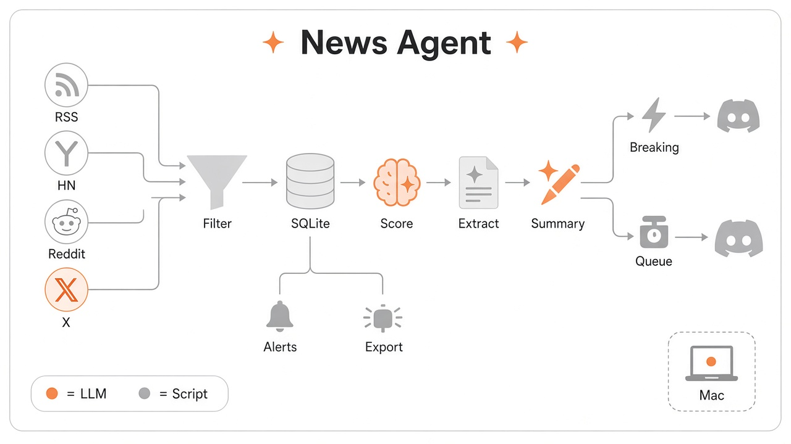

I once added an AI news agent to a game-industry vibe coding community I used to run. I'll call it the news bot from here on. Claude wrote the code in one night. The slow part came after: getting the bot to cut the right things and publish the right things took close to a month. I don't use the bot anymore. These notes come from the numbers left in the commit history.

## Why I built it

People who care about a topic find the news themselves. Beginners don't. For someone just starting out, even finding where the information lives is a wall. If fresh news showed up in the community channel on its own, that was one wall I could take down.

The structure is simple. It collects posts from RSS, Hacker News, Reddit, and X. An LLM scores each one for how useful it is to game developers. Posts that pass get a summary and go to a Discord channel. It ran on schedule on a single Mac through launchd.

## The build took one night

I wrote the spec, pipeline design, and implementation plan first. The next evening Claude committed the collectors, storage, scoring, summaries, and delivery from that plan in under 20 minutes. Right after, it fixed a handful of bugs: duplicate sends, Discord's character limit, SQLite locks during concurrent runs.

I left all the code to Claude. My job was to look at what actually got collected and posted, and when something looked wrong, tell it to fix the prompt or the collection logic. Most of the trial and error below started that way. I noticed something off and ordered an inspection. Claude recorded the cause and the numbers in the commits.

## Week one: cutting down

The first version wrote three summaries per post, one each for game designers, programmers, and artists. It was long and gave no more reason to read. The next day I switched to a single line, sent as plain text with a link instead of a Discord embed.

I also raised the bar. At first a 3 out of 5 passed. But the "good to know" 3s piled up faster than the daily cap of 7 could drain them: 10 of the last 12 passes over three days were 3s. So only 4 and up went out, and anything left in the queue for three days expired.

There was a security hole too. Feed titles and summaries went straight into messages, so a headline with `@everyone` could ping the whole channel. Turning off all mentions on send closed it. A bot that reposts outside text into a channel should have mentions off from the start.

## The filters were throwing away the good stuff

The real problems showed up about two weeks in. The bot ran fine, but the posts worth reading weren't coming through.

First, the keyword prefilter. Korean game outlets publish a lot, so a keyword pass ran before the LLM. That list was validated only against old logs. Nobody checked what survived once it was live. In production it dropped 18 of 22 in-window articles from one outlet, and 3 of the 4 survivors were game sale posts caught by "Steam." That keyword pulled 31 titles over 13 days and none scored 3 or higher. In the end the keywords were rechosen by measuring how many useful posts each one caught across 490 real titles, and those numbers went into the config so the next edit starts from evidence.

Second, one line in the scoring rubric. The 2-point anchor said "4 points is limited to third-party conference technical sessions." The line was meant to keep promotional pieces from scoring 4. But it didn't say that, so it applied to everything, and no practitioner post could reach 4 either. Score-4 items hit zero for three straight days and nothing was published. The rule now applies only to promotional coverage, and a practitioner post can reach 4 if it has two of three things: the stage it targets, the method, and the outcome. While looking into this I also found that unvetted personal projects had been going out unmarked. Six had shipped that way, three of them asking for feedback on unfinished work. Those now carry an unvetted label.

Third, open-weight models. Of 16 open-weight items in the database, 15 were cut, topping out at 3 with reasons like "limited direct impact on game dev pipelines." For this community that's the wrong call. A model you can run locally can matter more to a solo developer than another API-only model. Open weights went into the rubric, and the labs that release them went into the X account list.

Some things never got in at all. The MCP spec released on July 28 never entered the pipeline. Nothing broke. There was simply no path for it. The Hacker News keywords had nothing on agents or tool standards like MCP, and Korean outlets didn't put "MCP" in headlines. Qwen was similar: its keyword was dropped after a 48-hour sample turned up only 3 matches, all in URLs, but a 30-day window showed 11 new title matches.

In every case the bot ran with no errors. That's why it took so long to notice. If I hadn't looked at the output myself, I never would have known.

## From Grok to Claude

Scoring and summaries first ran on Grok through the xAI API. Grok didn't perform as well as I wanted, so I moved them to the Claude CLI. X collection needs x_search, so in the last config it still runs on Grok.

X had its own small trap. If the account list goes past 20, the rest gets cut with no warning. Add accounts without checking the count and the new ones quietly drop out.

## Looking back

I decided one thing at the start: split the probabilistic parts from the deterministic parts. The LLM runs only where judgment is needed, and anything a fixed rule can handle goes to a script. A big reason was to cut down on LLM calls, so the scripts ended up doing more than you'd expect.

- **Scripts**: collecting from RSS, Hacker News, and Reddit. Title keyword prefilters per outlet. URL normalization and hashing to drop identical links. Body extraction. The queue, the daily send cap, and expiring posts older than three days. Sending to Discord with mentions disabled. Scheduled runs and the run lock.
- **LLM**: scoring, same-event judgment, and the one-line summary. X was the exception. Collection itself had to go through x_search, so the LLM was in the collection step there too.

The split makes it clear where to fix things. If a keyword filter drops too much, measure it and fix the list. If scores look wrong, look at the prompt. And the one place where I let the LLM judge even a little, X collection, is where it broke. The collection prompt asked only for news "meaningful to game developers," and for two days nothing came in from X. It was fixed only when collection took everything and all judgment moved to the scoring step.

Pulling from many sources meant few stories slipped through. It also made dedup hard. The same announcement comes in separately from the official blog, press articles, HN, and X. A script can't catch that, so I kept revising the prompt sent to the LLM.

- **At first**: the only check was a hash of the normalized URL. Different link, different post.
- **July 23**: a Unity keynote went out 4 times in 27 hours, 3 of them time-shifted re-reports from the same feed. Now a list of recent titles goes with each batch, and a same-event item gets 1 point no matter the outlet or format. This rule overrides the other scoring anchors.
- **July 25**: an official release post scored 2 for "release unconfirmed" and got cut. The URL wasn't in the prompt, so there was no way to tell it was the primary source. Now the URL goes in, and for the same event the primary source wins.
- **July 26**: this time both were primary sources. One model launch went out twice, one second apart, as a blog post and a console page, then again two days later from X. The old rule only deduped "when there is no primary source." Now it always keeps exactly one, with a set order for which to keep.
- **August 12**: tracing 5 duplicate publishes turned up three holes. Re-reports landed 3, 7, and 14 days later, but the reference window was 48 hours. Korean and English coverage of the same event didn't match on title alone. And when the primary source arrived later, there was no way to pull the item already queued. The window went to 14 days, date and source now go along with each title, and a better-sourced item can push out its queued duplicate.

Looking back, dedup wasn't something you solve once. Close one hole and the next one showed up in real publishes. Repeats stopped only once each real case was pinned into the test data.

## A sign-up bot, briefly

I also made a first-come sign-up bot for the community. Each option has a cap, and when a seat opens the next person on the waitlist moves up and gets a DM. Review caught one bug. The bot replied that the people who lost their spots had been DM'd, before it had sent a single DM. Someone with DMs closed would lose their seat without knowing, and nobody else would know either. Now the DMs go first and the reply names whoever couldn't be reached.

## So how did it go

Participation wasn't high. Feedback came now and then, and some people said it helped. I don't use the bot anymore.

Hand the code to an agent and the build is done fast. The time goes into looking at the output yourself and fixing the criteria, and that lasts as long as the bot runs. When a filter is quietly wrong instead of erroring, the logs won't tell you. You have to look at what went out and what got thrown away.
