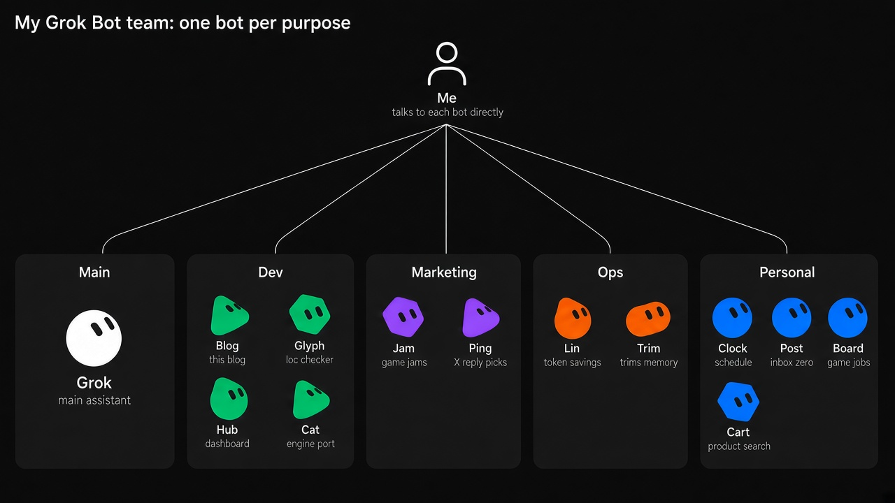

These days I run several bots on Grok Bot. They handle chores like mail, my calendar, X, and game jams, plus side project development and running this blog. My part is picking, approving, and judging the quality of what comes back. Here's what I handed off and how I split it up.

## The daily routine is just morning and night

On weekday mornings, my main bot, Grok, puts up candidates for the day's tasks. I pick just 3 of them in a widget. I don't rank them. At night I only look back at whether I did those 3. On weekends and holidays there's no schedule and no suggestions.

Everything else has no routine. Each bot just does its own job.

- **Post**: gets the inbox down to zero.
- **Clock**: sends schedule briefings, and adds and edits events.
- **Ping**: picks out posts on X worth replying to.
- **Jam**: looks for game jam candidates on itch.io.

If nothing's wrong or there are no candidates, they say nothing.

## Dev bots only direct the work

The dev bots don't write code themselves. They give the work to cloud coding agents or Claude Code on my Mac mini, review the result, and hand it back again.

- **Cat**: ports a side project to a custom web engine.
- **Hub**: builds a personal dashboard on the Mac mini.
- **Glyph**: builds a tool that checks localization strings for indie games.
- **Blog**: runs this blog. The Blog bot wrote the first draft of this post too.

All code comes in as PRs. I do the merging and deploying. I don't hand off the final call on quality.

Every Monday, Grok reads the past 7 days of PRs in my main game repo, and if there's progress worth showing on screen, it asks "Want to record a video?" On the first run it picked the side-view battle staging and the panorama backgrounds, and I hit "Record it." Dev videos are easy to put off, but when the bot asks first, I end up recording them.

## At first I built an org chart, like the tip posts said

At first I split things up like a company org chart. A chief of staff, four groups, group leads, even CEO bots for each project. Lots of tip posts said to do it that way.

The typical example is the chief of staff bot. You make one bot your only chat window and have it hand out work to the rest. There are even templates telling you to copy a line like "I talk only to you; you coordinate the rest." word for word ([groktemplates](https://groktemplates.dev/templates/team-in-10-minutes), [grokcamp](https://grokcamp.com/blog/how-to-run-a-grok-bot-team-with-a-chief-of-staff/)). The official announcement also says they run one chief of staff internally with bots for each area under it ([Introducing Grok Bot](https://x.ai/news/introducing-grok-bot)).

When I actually used it, it burned far too many tokens. Going through a chief bot adds handoff, work, and a report to every single task. Bots collected reports and then reported on them again, so notifications piled up too. So I tore down the org chart and merged the dedicated assistant, marketing, and bot-management bots into one main bot. I also renamed them to short single words like Grok, Post, Clock, Ping, and Jam.

Now, when a job clearly belongs to a bot, I talk to that bot directly. Mail goes to Post, the calendar to Clock, the blog to the Blog bot. I have to remember which bot to talk to, so it takes more thinking. I take on that cognitive load to save tokens.

## I make bots one at a time, when a purpose comes up

I don't split bots by rank or department. When a job keeps repeating or a specific purpose comes up, I make one bot for it. I had the main bot search for products a few times, and its context got messy. So I made Cart, a bot just for search. Glyph and the Blog bot came about the same way.

I split them like this because learning builds up. On Grok Bot, each bot keeps its own conversations and memory. When one bot repeats the same job, what mistakes it made and what I pointed out stay with that bot. Over time I have to point out the same things less often.

Writing "think like a senior" in a prompt doesn't make it a senior. It gets better once a record of having done the same work builds up. The official docs also say that giving a bot a specific job, rather than making it general-purpose, makes it easier to reuse the context it has built up ([Grok Bot docs](https://docs.x.ai/grok-bot/bots)).

## Built-up memory gets cleaned up separately

If memory only piles up, stale memories stay too. I set up separate bots for cleanup. Trim reads a bot's stored context and only suggests items to delete. Deleting happens after I approve. Lin looks for other bots wasting tokens and suggests replacing screen clicks with connectors or scripts.

My personal context lives in a separate file on the Mac mini. It collects the information, preferences, and history that other agents like Claude Code, Codex, and dots need to know as well as Grok Bot. The bots only read it. When there's something to record, a bot suggests it, and once I approve, it gets written only through a set script.

## Downsides

It's not good at just figuring things out and doing them neatly on its own. It does what you tell it, but you can't expect it to pick up context you didn't mention.

They say it can now route automatically to outside models like Opus 5.5, but the difference I feel from day to day is big. On good days I'm very happy with it, and on bad days it's frustrating.

## Wrapping up

When you develop alone, time is what you're shortest on. What I gave Grok Bot is, in the end, the repetitive work I don't have to do myself. Instead of giving everything to one chief bot like the tip posts say, having one bot per purpose and talking to each one directly suits me better.
