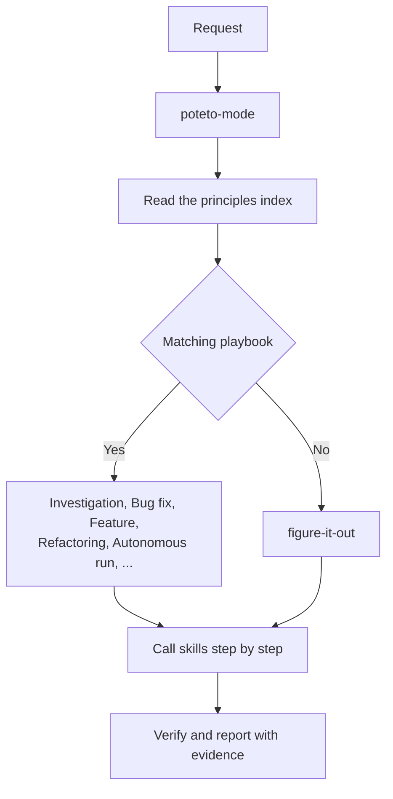
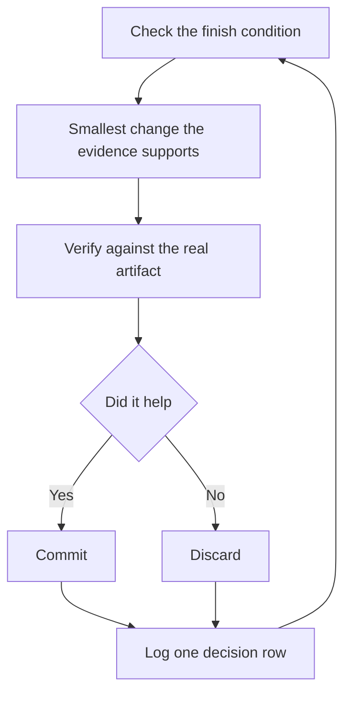

You hear it a lot lately: AI writes too much code, and too much of it is sloppy. poteto, who made pstack, starts from the same place. According to the README, he has worked with millions of lines of code at Meta, Netflix, and Cursor, and he helps build and maintain React Compiler. Near the top of the README there's this line:

> if you want to go fast, go deep first.

pstack is that sentence turned into a pack of skills. It shipped as a Cursor plugin, and it now installs officially in Claude Code too.

I've hooked pstack into a personal game project and handed most of the development over to agents. This post isn't about my setup, though. I want to write down what pstack believes, how those beliefs are organized, and why that structure makes it safe to leave an agent running on its own.

## What pstack believes

Read the README, the guide, and the skill files, and the same ideas keep coming back. I'd boil them down to five.

### 1. Quality over volume

> throughput without quality is not a goal

poteto says the point of pstack is to write less code, not more. The first principle in the list, Laziness Protocol, says to pick the smallest change that solves the problem. At a time when agents pour out code with no effort, pstack deliberately goes the other way.

### 2. Trust comes before parallelism

> fearless parallelism

The README says pstack lets you parallelize without fear, and it attaches a condition. You go deep on one agent first, and you have to be able to trust it to write good, verifiable code. Parallelism follows from trust. Getting one agent you can rely on comes before spinning up many.

### 3. Done means actually checked

> not a proxy, self-report, or 'it compiles.'

That's from the Prove It Works principle. A passing build or an agent saying "done" is not evidence. You run the real feature, read the real value, look at the real diff. Where possible, the check becomes a script that someone else can rerun. poteto-mode holds its replies to the same bar: every claim carries its evidence, or says in the same sentence whether it was measured, inferred, or guessed.

### 4. Give a goal and a check, not instructions

> how you'll know it's done

The guide opens by telling you to stop micromanaging the agent. Say what you want and how you'll know it's done. That's also why pstack ships no skill whose only job is planning. In the README, poteto says he doesn't believe in planning and that the best spec is code.

For the same reason, the agent checks before it asks. A question it could answer by running something, like behavior, timing, or layout, isn't the human's to answer. It builds a prototype and lets the result decide.

### 5. Lessons go into structure, not more text

> The instruction is the symptom.

That's the last line of the Encode Lessons in Structure principle. If you find yourself giving the same correction twice, stop writing instructions and block the mistake with a lint, a runtime check, or a script. The guide even ranks the fixes. Making the mistake impossible through architecture is best, then types, lint, and CI, then tests. Docs come last, because nothing fails when an agent ignores a rule.

## How it's built

The structure is simple. There's one entry point, 23 playbooks and 24 principles behind it, and situational skills that get pulled in when needed.

### The entry point: poteto-mode

Almost everything starts with `/poteto-mode`. It reads the request, picks a playbook, and copies that playbook's steps verbatim to the top of the todo list. A skipped step isn't deleted. It stays in the list with a one-line reason. Later you can see from the list what the agent did and what it chose not to do, and why.

### 23 playbooks

A playbook is the procedure for one kind of work. Roughly, they fall into five groups:

- Understanding: investigation, runtime forensics, trace forensics
- Changing: bug fix, feature, refactoring, perf, hillclimb, prototype, visual parity
- Working on skills: authoring a skill, eval
- Getting it out: opening a PR, babysit, shipping, multi-phase plan
- Long-running work: autonomous run, orchestrate, two kinds of autopilot, session pickup, pause safely, worktree cleanup

If nothing fits, the job is large, or you're stepping away and will check it later, the request goes to `figure-it-out`, which designs a new playbook for that task.

### 24 principles

Each principle is its own skill. There are 10 core, 6 architecture, 5 verification, 2 delegation, and 1 meta. poteto-mode reads the principles index when it starts, and its reply has to name which principle changed which decision. It can only cite principles it actually read in that session.

Principles also have a particular way of being used. Chapter 8 of the guide explains that you don't invoke principles, you steer with their names. If the agent is about to bolt a fourth adapter onto three existing ones, you just say "subtract before you add." The name carries a full rule the agent has already read, so it lands more precisely than a paragraph of instructions.

### Situational skills

The remaining skills are called when a step needs them. You can call them directly too.

- Understanding: `/how` explains how the code runs now, `/why` digs up why it was built that way, and `/teach` weaves the two together.
- Design: `/architect` settles types and boundaries before implementation. `/arena` runs several attempts at the same task and grafts the best parts together.
- Fan-out and review: `/swarm` splits work across many workers and returns one report. `/interrogate` has other models try to break a diff.
- Records: `/show-me-your-work` keeps a decision log, and `/ketchup` tells you in plain words what changed in the meantime.
- Self-repair: `/reflect` turns what a finished task taught into a skill edit, and `/correct` blocks repeated mistakes in the structure of the repo.

### Model roles

`/setup-pstack` writes one rule file that maps each role to a model. There are separate roles for writing code, for judgment and prose, for the hardest tasks, and for the review panels. By default code goes to a fast coding model, and judgment and prose go to a heavier one. The `/interrogate` skill shows the thinking behind this. Its adversarial signal comes from model diversity, not from personas assigned to reviewers. poteto-mode takes the same view: a second opinion is the same prompt against a different model, and when the two agree, that's a strong signal.

## How the philosophy becomes autonomy

Chapter 7 of the guide is called "Run work while you sleep." The guide calls it the payoff for everything before it. An agent that verifies its own work is an agent you can leave alone with a hard task. This is where the five beliefs above turn into concrete mechanisms.

### Trust before the loop

> A loop you don't trust just produces unchecked work faster

So before you leave a loop running, the guide asks you to check four things:

1. You've done the task once by hand, or watched an agent do it, so you know what good looks like.
2. The agent has the same tools and signals you'd use, such as the verification skill, the profiler, and the logs.
3. Every stage proves its work and can stop the line when the work misses the bar.
4. You've read a few transcripts and turned the repeated failures into tools, skills, or checks.

Until all four hold, run it while you watch.

### The overnight contract

The handoff when you step away has four parts: the goal, the finish condition, what you've given permission for, and a way out when it gets stuck. "Going to bed" is a signal to stop asking and keep going. "Don't ask me before committing" answers ahead of time the permission the agent would otherwise stop for. And the escape hatch says that if it hits a genuine dead end, it should stop and write up why. The guide says that beats eight hours of creative goal reinterpretation.

The chapter ends with a warning:

> a duration is not a finish condition

"Work on this for four hours" gives the agent nothing to check. You come back to four hours of motion instead of a result. The finish condition has to be something that can pass or fail.

### One change, one check, one log row

The Autonomous run playbook makes the point in its first line: the agent owns the exit condition. Before the first iteration, it has to state that condition as something checkable, such as tests green, the repro fixed, N PRs merged, or a pixel diff of zero. Then it goes around the same loop.

A change added because it "might help" gets reverted, not left in. A plateau isn't a reason to stop. The agent changes its approach instead. And it never quietly lowers the bar to declare victory. Broken skills or related bugs it finds along the way are its to fix. Reversible work doesn't get parked for the human.

### The brief is the product

Programs that run for days go to the Orchestrate playbook. One coordinator chat directs dozens to hundreds of subagents. The coordinator owns the program but never writes the code itself.

> The brief is the product.

The only thing the coordinator produces is the brief it hands each subagent. A worker can't ask the coordinator a question, so a vague brief fails quietly. That's why every brief carries the goal, the paths it may write, context, acceptance criteria, verify commands, a timebox, what's forbidden, and the report format. At the end come the standing orders: a numbered list with one constraint per line, such as model policy, the verification bar, and paths not to touch. That list is pasted verbatim into every new spawn and every resume. Directives decay across resumes, and each one that drops costs a human turn.

### Nobody merges their own code on their own say-so

The Autopilot-full playbook, which drives a queue of independent PRs to merged, splits the roles this way. The root agent owns the verdicts, never the PRs. Each PR gets one owner agent that builds it and carries it through merge. But it can only merge after a swarm of verifiers that never wrote the code has proven it.

> Green CI alone never authorizes a merge.

Anything that loosens a gate, such as a raised budget or a new allowlist entry, needs a verifier's proof and then a fresh countersign from the root, because the owner is the one who wants green. Long runs drift and agents stall silently, so the root also arms an hourly loop to audit itself.

### The morning audit

You review the night's work through the log `/show-me-your-work` keeps. One row per decision, in a TSV: time, phase, decision, reason, evidence, and result. The evidence cell holds a pointer, like a commit hash, a PR number, or a file location, never a paragraph.

Before handing back, the skill spawns a model from a different family than the one that did the work, and has it read the log and the transcript. Self-review is not a substitute. The reply ends with an Attention section listing what deserves your scrutiny. In the morning you read that first, then follow it to the rows it points at.

## Don't wait on the human, and where that stops

Underneath all this sits the Never Block on the Human principle. Its premise is that the human supervises asynchronously. The agent makes reasonable decisions and keeps going, and the human course-corrects afterward. Code changes are reversible and reviewable, so a wrong decision usually costs less than blocking. Don't ask "should I do X?" Do X, and explain why.

The boundary is clear too. Irreversible actions, like a force-push, deleting production data, or sending external messages, still require confirmation. Product direction comes from the human. Only execution doesn't wait. The autonomy rules in poteto-mode draw the same line: reversible work proceeds without asking, and it always pauses before things like deploys or data deletion.

This principle has a partner. poteto-mode says that no is an acceptable answer. When someone proposes something or shows an approach, the agent should give its real judgment before following along. If it disagrees, it can decline or push back. Agreement is not the default.

## My setup

I use pstack, adapted for Claude Code, in a personal game project. The roles split like this:

- Claude coordinates and reviews everything. When there's no problem, it merges on its own.
- Codex does the actual coding.
- I give only a rough scope, the goal, and what to focus on. Claude decides how to group the work.
- Anything that needs my eyes waits and gets reported to me.

The current session has been running for almost two weeks. My only instruction was "use the tokens." Since then it has been doing optimization, visual polish, and code review on its own.

## My take

I wanted to apply pstack conservatively at first, so I turned off Never Block on the Human. It's still off. I think it could be turned on now.

I haven't decided whether to keep my adapted version or switch to the original plugin, which now officially supports Claude Code. That needs a closer look.

Watching a session that has run for nearly two weeks, it seems to judge on its own based on the instructions I've built up over time.

On the surface, "use the tokens" is exactly the kind of instruction the guide warns about. Time isn't a finish condition, and this instruction has none. I think it works well anyway, and precisely because of pstack. In pstack the agent sets its own finish conditions and owns them. So even a vague instruction gets turned into small goals it can check, and it works through them one at a time.
