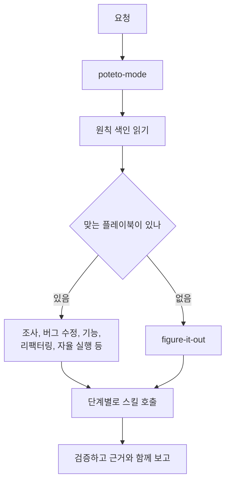
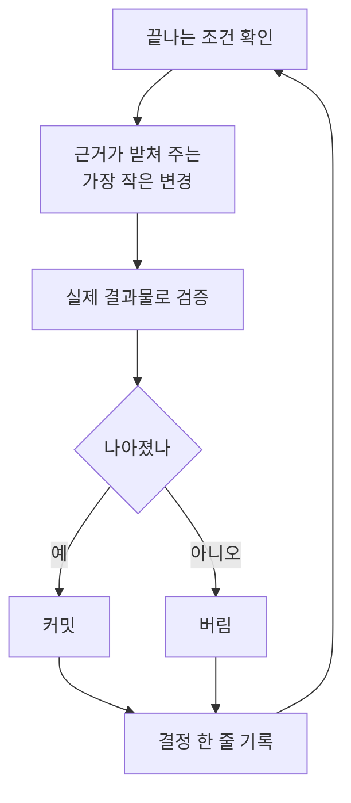

AI가 쓰는 코드가 너무 많고 너무 엉성하다는 말이 요즘 자주 들린다. pstack을 만든 poteto도 같은 생각에서 출발한다. README 소개에 따르면 그는 Meta, Netflix, Cursor에서 수백만 줄 규모의 코드를 다뤄 왔고, React Compiler를 만들고 관리하는 일을 돕고 있다. README 첫머리에 이런 문장이 있다.

> if you want to go fast, go deep first.

빨리 가고 싶으면 먼저 깊이 가라는 뜻이다. pstack은 이 문장을 스킬 묶음으로 만든 것이다. Cursor 플러그인으로 나왔고, 지금은 Claude Code에서도 공식으로 설치할 수 있다.

나는 pstack을 개인 게임 프로젝트에 붙여서 에이전트에게 개발을 거의 통째로 맡기고 있다. 그런데 이 글에서 하고 싶은 얘기는 내 설정이 아니다. pstack이 무엇을 믿는지, 그 믿음이 어떤 구조로 짜여 있는지, 그리고 그 구조가 왜 에이전트를 혼자 돌려도 되는 상태로 만드는지를 적어 보려 한다.

## pstack이 믿는 것

README와 가이드, 스킬 파일을 읽어 보면 같은 생각이 계속 반복된다. 다섯 가지로 추리면 이렇다.

### 1. 양보다 질이다

> throughput without quality is not a goal

품질 없이 처리량만 늘리는 건 목표가 아니라는 말이다. poteto는 pstack의 목표가 코드 줄 수를 늘리는 게 아니라 오히려 줄이는 데 있다고 한다. 원칙 가운데 첫 번째인 Laziness Protocol도 문제를 푸는 가장 작은 변경을 고르라고 한다. 에이전트가 코드를 쉽게 쏟아내는 시대에 일부러 반대로 가는 셈이다.

### 2. 믿을 수 있어야 병렬로 돌린다

> fearless parallelism

README는 pstack이 겁 없이 병렬로 일하게 해 준다고 말한다. 조건이 붙어 있다. 에이전트 하나를 깊게 다루고, 그 에이전트가 검증 가능한 좋은 코드를 쓴다고 믿을 수 있어야 한다. 병렬은 믿음의 결과이지 출발점이 아니다. 에이전트를 여러 개 띄우는 것보다 하나를 믿을 수 있게 만드는 게 먼저다.

### 3. 끝났다는 건 진짜로 확인했다는 뜻이다

> not a proxy, self-report, or 'it compiles.'

Prove It Works 원칙의 한 구절이다. 빌드가 통과했다거나 에이전트가 됐다고 말했다는 건 증거가 아니다. 실제 기능을 돌려 보고, 실제 값을 읽고, 실제 diff를 봐야 한다. 가능하면 확인 과정을 스크립트로 만들어서 다른 사람이 다시 돌려 볼 수 있게 남긴다. poteto-mode는 답변에도 같은 기준을 건다. 모든 주장에 그 근거를 붙이거나, 측정한 것인지 추론한 것인지 짐작인지 같은 문장 안에서 밝히라고 한다.

### 4. 지시가 아니라 목표와 확인 방법을 준다

> how you'll know it's done

가이드 첫머리는 에이전트를 일일이 관리하지 말라고 한다. 원하는 것과 그게 끝났는지 알 수 있는 방법만 말하면 된다. pstack에 따로 계획만 세우는 스킬을 두지 않은 것도 같은 맥락이다. README에서 poteto는 계획을 믿지 않는다고 쓰고, 가장 좋은 명세는 코드라고 덧붙였다.

같은 이유로 에이전트는 사람에게 묻기 전에 먼저 확인한다. 직접 돌려 보면 알 수 있는 질문, 예를 들어 동작이나 속도나 레이아웃 같은 건 사람이 답할 문제가 아니라고 본다. 시제품을 만들어 보고 그 결과로 정한다.

### 5. 배운 건 글이 아니라 구조로 남긴다

> The instruction is the symptom.

Encode Lessons in Structure 원칙의 마지막 문장이다. 같은 지적을 두 번 하게 되면 지시문을 더 쓰지 말고 린트나 런타임 검사나 스크립트로 막으라는 얘기다. 가이드는 고치는 방법에 순서도 매긴다. 아키텍처로 실수를 불가능하게 만드는 게 가장 좋고, 그다음이 타입과 린트와 CI, 그다음이 테스트다. 문서는 맨 마지막이다. 에이전트가 규칙을 무시해도 아무것도 실패하지 않기 때문이다.

## 어떻게 생겼나

pstack의 구조는 단순하다. 입구가 하나 있고, 그 뒤에 플레이북 23개와 원칙 24개가 있고, 필요할 때 불려 나오는 상황별 스킬이 있다.

### 입구: poteto-mode

거의 모든 일은 `/poteto-mode`로 시작한다. 요청을 읽고 맞는 플레이북을 고른 다음, 그 플레이북의 단계를 할 일 목록 맨 앞에 그대로 옮겨 적는다. 건너뛰는 단계도 지우지 않고 이유를 한 줄 붙여 남긴다. 그래서 나중에 보면 에이전트가 무엇을 했고 무엇을 왜 안 했는지가 목록에 다 남는다.

### 플레이북 23개

플레이북은 일의 종류별 절차다. 크게 나누면 다섯 묶음이다.

- 이해하기: 조사, 런타임 증상 진단, 프로파일 기록 진단
- 바꾸기: 버그 수정, 기능, 리팩터링, 성능, 지표 끌어올리기, 시제품, 화면 일치
- 스킬 다루기: 스킬 작성, 평가
- 내보내기: PR 열기, PR 돌보기, 배포, 여러 단계 계획
- 오래 맡기기: 자율 실행, 오케스트레이션, 오토파일럿 두 종류, 세션 이어받기, 안전하게 멈추기, 작업 공간 정리

어디에도 맞지 않거나, 일이 크거나, 사람이 자리를 비웠다가 나중에 확인할 일이면 `figure-it-out`으로 간다. 이 스킬은 그 일에 맞는 플레이북을 새로 설계한다.

### 원칙 24개

원칙은 하나에 스킬 하나씩이다. 핵심 10개, 아키텍처 6개, 검증 5개, 위임 2개, 메타 1개로 나뉜다. poteto-mode는 일을 시작할 때 원칙 색인을 읽고, 답변에서 어떤 원칙이 어떤 결정을 바꿨는지 밝혀야 한다. 그 세션에서 실제로 읽은 원칙만 인용할 수 있다.

원칙은 쓰는 방식이 따로 있다. 가이드 8장은 사람이 원칙을 실행하는 게 아니라 원칙 이름으로 방향을 튼다고 설명한다. 에이전트가 기존 어댑터 세 개 위에 하나를 더 얹으려 하면 "subtract before you add"라고 한마디만 하면 된다. 이름 뒤에 에이전트가 이미 읽은 규칙이 통째로 붙어 있어서, 긴 설명보다 정확하게 먹힌다.

### 상황별 스킬

나머지 스킬은 단계가 필요로 할 때 불려 나온다. 직접 부를 수도 있다.

- 이해: `/how`는 지금 코드가 어떻게 도는지, `/why`는 왜 그렇게 만들어졌는지 찾는다. `/teach`는 둘을 엮어 설명한다.
- 설계: `/architect`는 구현 전에 타입과 경계를 정한다. `/arena`는 같은 과제를 여러 번 시도해서 좋은 부분을 합친다.
- 병렬과 검토: `/swarm`은 일을 쪼개 여러 작업자에게 맡기고 보고서 하나로 모은다. `/interrogate`는 다른 모델들이 diff를 깨 보게 한다.
- 기록: `/show-me-your-work`는 결정 기록을 남기고, `/ketchup`은 그사이 바뀐 것을 쉬운 말로 알려 준다.
- 스스로 고치기: `/reflect`는 끝난 작업에서 배운 것을 스킬 수정으로 남기고, `/correct`는 반복되는 실수를 저장소 구조로 막는다.

### 모델 역할

`/setup-pstack`은 역할마다 어떤 모델을 쓸지 정하는 규칙 파일 하나를 쓴다. 코드를 쓰는 역할, 판단과 글을 맡는 역할, 가장 어려운 일, 검토 패널이 따로 있다. 기본값은 코드 작업을 빠른 코딩 모델에, 판단과 글은 더 무거운 모델에 보낸다. `/interrogate`의 설명이 이 설계를 잘 보여 준다. 적대적 검토의 힘은 리뷰어에게 씌운 역할극이 아니라 모델이 서로 다르다는 데서 나온다고 한다. poteto-mode도 같은 프롬프트를 다른 모델에 던진 게 두 번째 의견이고, 둘이 같은 답을 내면 그만큼 믿을 만하다고 본다.

## 철학이 자율 실행이 되는 방식

가이드 7장 제목은 "Run work while you sleep"이다. 잠든 사이에 일을 시키는 장이다. 가이드는 이게 앞 장들의 보상이라고 말한다. 자기 일을 스스로 검증하는 에이전트라면 어려운 일을 맡기고 자리를 떠도 된다는 것이다. 여기서 앞의 다섯 가지 믿음이 실제 장치로 바뀐다.

### 루프보다 믿음이 먼저다

> A loop you don't trust just produces unchecked work faster

믿지 못하는 루프는 확인 안 된 일을 더 빨리 만들어 낼 뿐이다. 그래서 가이드는 루프를 켜기 전에 네 가지를 확인하라고 한다.

1. 그 일을 직접 한 번 해 봤거나, 에이전트가 하는 걸 지켜봐서 잘된 결과가 어떤 모습인지 안다.
2. 에이전트가 내가 쓰는 도구와 신호를 똑같이 쓸 수 있다. 검증 스킬, 프로파일러, 로그 같은 것들이다.
3. 단계마다 자기 결과를 증명하고, 기준에 못 미치면 작업을 멈춰 세울 수 있다.
4. 기록을 몇 개 읽어 보고, 반복되는 실패를 도구나 스킬이나 검사로 바꿔 뒀다.

넷이 다 맞을 때까지는 지켜보면서 돌리라고 한다.

### 밤샘 계약

자리를 비울 때 넘기는 지시에는 네 가지가 들어간다. 목표, 끝났다고 볼 조건, 허락해 둔 것, 그리고 막혔을 때 빠져나올 길이다. "자러 간다"는 말은 에이전트에게 묻지 말고 계속하라는 신호가 된다. "커밋 전에 묻지 마"는 에이전트가 멈춰 설 만한 허락을 미리 줘 둔다. 진짜 막다른 길이면 멈추고 이유를 적으라는 탈출구도 둔다. 가이드는 그게 여덟 시간 동안 목표를 제멋대로 다시 해석하는 것보다 낫다고 한다.

이 장 끝에 경고가 하나 있다.

> a duration is not a finish condition

시간은 끝나는 조건이 아니다. "네 시간 동안 이거 해"라고 하면 에이전트는 확인할 게 없다. 그러면 결과 대신 네 시간 동안 움직인 흔적만 남는다. 통과하거나 실패할 수 있는 조건을 줘야 한다.

### 한 번에 하나씩 바꾸고, 확인하고, 남긴다

Autonomous run 플레이북은 첫 줄부터 분명하다. 끝나는 조건은 에이전트가 책임진다. 첫 반복을 돌기 전에 그 조건을 확인 가능한 형태로 적어야 한다. 테스트 통과, 재현 해결, PR N개 머지, 픽셀 차이 0 같은 식이다. 그다음은 같은 고리를 계속 돈다.

도움이 될지도 모른다는 이유로 넣은 변경은 남기지 않고 되돌린다. 정체가 와도 멈추지 않고 방법을 바꾼다. 그리고 승리를 선언하려고 조건을 슬쩍 낮추는 일은 절대 하지 않는다. 일하다 발견한 깨진 스킬이나 관련 버그도 에이전트가 직접 처리한다. 되돌릴 수 있는 일을 사람에게 미뤄 두지 않는다.

### 브리프가 곧 결과물이다

여러 날 이어지는 큰 프로그램은 Orchestrate 플레이북이 맡는다. 조정자 채팅 하나가 하위 에이전트 수십에서 수백 개를 부린다. 조정자는 프로그램을 책임지지만 코드는 직접 쓰지 않는다.

> The brief is the product.

조정자가 만드는 유일한 결과물은 하위 에이전트에게 주는 브리프다. 작업자는 조정자에게 되물을 수 없기 때문에, 모호한 브리프는 조용히 실패한다. 그래서 브리프에는 목표, 쓸 수 있는 경로, 맥락, 완료 기준, 검증 명령, 시간 상한, 금지 사항, 보고 형식이 다 들어간다. 맨 끝에는 상시 지시가 붙는다. 모델 정책, 검증 기준, 건드리면 안 되는 경로 같은 걸 한 줄에 하나씩 적은 목록이다. 이 목록은 새로 띄울 때도, 다시 이어갈 때도 그대로 붙여 넣는다. 지시는 세션을 이어 갈수록 흐려지고, 빠진 지시 하나가 사람 손을 한 번 더 부르기 때문이다.

### 자기가 쓴 코드는 자기가 머지하지 않는다

독립된 PR 여러 개를 머지까지 밀고 가는 Autopilot-full 플레이북은 역할을 이렇게 나눈다. 루트 에이전트는 판정을 책임지고, PR은 책임지지 않는다. PR마다 담당 에이전트가 하나씩 붙어 만들고 머지까지 한다. 다만 머지는 코드를 한 줄도 쓰지 않은 검증자 무리가 증명한 다음에만 할 수 있다.

> Green CI alone never authorizes a merge.

CI가 초록색이라는 것만으로는 머지할 수 없다. 예산을 늘리거나 허용 목록에 항목을 더하는 것처럼 기준을 느슨하게 만드는 일은 검증자의 증명과 루트의 확인을 한 번 더 거친다. 초록불을 가장 원하는 쪽이 담당 에이전트 자신이기 때문이다. 긴 실행은 흐트러지고 에이전트는 소리 없이 멈추기도 해서, 한 시간마다 스스로 점검하는 루프도 건다.

### 아침에는 기록을 감사한다

밤새 돈 일은 `/show-me-your-work`가 남긴 기록으로 확인한다. 결정 하나에 한 줄씩, 시각, 단계, 결정, 이유, 근거, 결과를 TSV로 적는다. 근거 칸에는 설명 대신 커밋 해시나 PR 번호, 파일 위치 같은 포인터만 넣는다.

결과를 넘기기 전에 이 스킬은 일을 한 모델과 다른 계열의 모델을 불러 기록과 대화 내용을 읽게 한다. 스스로 검토하는 건 대신이 될 수 없다는 이유다. 답변 끝에는 사람이 눈여겨봐야 할 것을 모은 Attention 항목이 붙는다. 아침에는 그것부터 읽고, 거기서 가리키는 기록 줄을 따라가면 된다.

## 사람을 기다리지 마라, 그리고 그 경계

자율 실행의 바닥에는 Never Block on the Human 원칙이 있다. 사람은 비동기로 감독한다는 전제다. 에이전트는 멈추지 않고 합리적으로 결정해서 진행하고, 사람은 나중에 방향을 바로잡는다. 코드는 되돌릴 수 있고 검토할 수 있으니, 잘못된 결정 하나가 멈춰서 기다리는 것보다 대개 싸게 먹힌다는 논리다. "X를 해도 될까요?"라고 묻지 말고, X를 하고 왜 했는지 설명하라고 한다.

경계도 분명하다. 강제 푸시, 운영 데이터 삭제, 외부로 나가는 메시지처럼 되돌릴 수 없는 일은 여전히 확인을 받는다. 제품의 방향은 사람이 정한다. 실행만 사람을 기다리지 않는다. poteto-mode의 자율 규칙도 같은 선을 긋는다. 되돌릴 수 있는 일은 묻지 않고 진행하고, 배포나 데이터 삭제 같은 일 앞에서는 항상 멈춘다.

이 원칙에는 짝이 하나 더 있다. poteto-mode는 "아니요"도 괜찮은 대답이라고 적어 둔다. 사람이 무언가를 제안하거나 방법을 보여 주면, 에이전트는 따라가기 전에 자기 판단을 말해야 한다. 아니라고 보면 거절하거나 반대해도 된다. 동의가 기본값이 아니라는 것이다.

## 내 경우

나는 개인 게임 프로젝트에서 pstack을 Claude Code에 맞게 고쳐 쓰고 있다. 역할은 이렇게 나뉜다.

- Claude가 전체를 조율하고 검토한다. 문제가 없으면 머지까지 스스로 한다.
- 실제 코드 작업은 Codex가 한다.
- 나는 대략적인 범위와 목표, 어디에 집중할지만 말한다. 일을 어떻게 묶을지는 Claude가 정한다.
- 내가 봐야 하는 일은 멈춰 두고 나에게 보고한다.

지금 돌고 있는 세션은 거의 2주째다. 내가 한 지시는 "토큰을 써라" 하나뿐이다. 그 뒤로 최적화, 화면 다듬기, 코드 리뷰를 알아서 하고 있다.

## 내 생각

처음에는 pstack을 보수적으로 적용하고 싶어서 Never Block on the Human을 꺼 두었다. 지금도 꺼져 있다. 그런데 이제는 켜도 될 것 같다.

지금처럼 고쳐 쓴 버전을 계속 쓸지, Claude Code를 공식 지원하게 된 원래 플러그인으로 갈아탈지는 아직 정하지 못했다. 검토가 필요하다.

2주 가까이 이어진 세션을 보면, 그동안 내가 쌓아 온 지시를 바탕으로 스스로 판단하는 것처럼 보인다.

"토큰을 써라"는 겉으로 보면 가이드가 경고한 바로 그 지시다. 시간은 끝나는 조건이 아니라고 했는데, 이 지시에는 끝나는 조건이 없다. 그런데도 잘 돌아가는 건 오히려 pstack 덕분이라고 생각한다. pstack에서는 끝나는 조건을 에이전트가 직접 세우고 책임진다. 그래서 모호한 지시를 줘도 에이전트가 그걸 확인할 수 있는 작은 목표들로 바꿔서 하나씩 처리한다.
