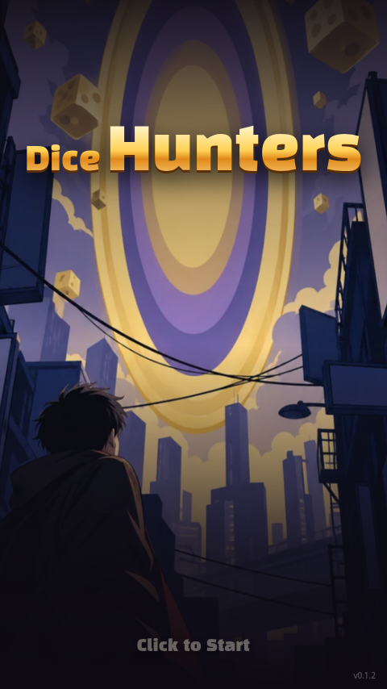
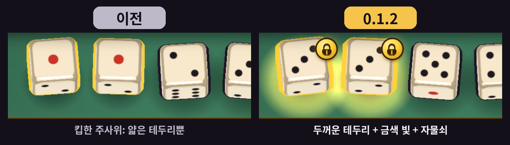
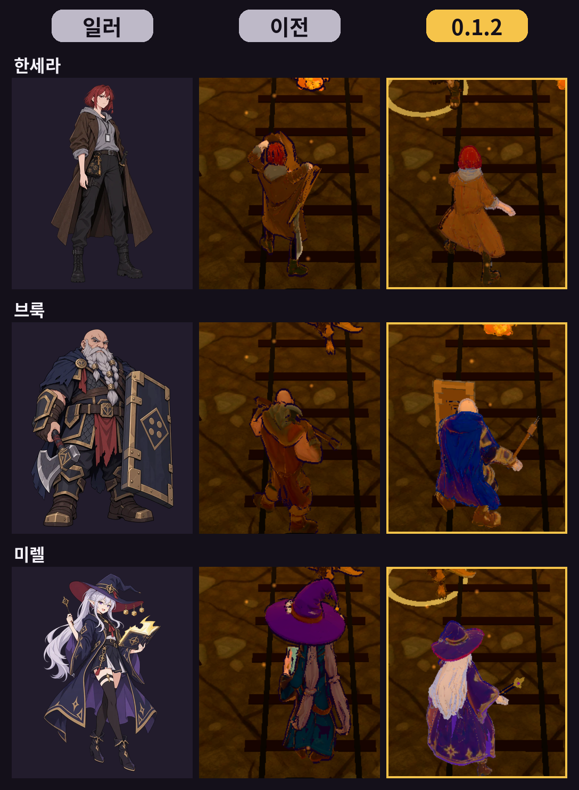
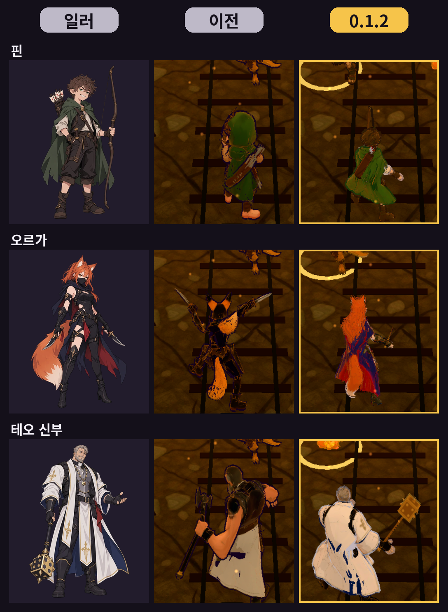

Dice Hunters 0.1.2 is out. There are no balance changes. Feedback from community comments is in this update.

## Kept dice and controls

Players said kept dice were hard to see. Kept dice now have a thick border, a gold glow, and a lock icon, so a kept die is easy to see.

Buttons now give press feedback: a pressed look and a sound. Rolling the dice vibrates. Vibration is Android only.

## Hero models

Players said the models looked different from the illustrations, so all six hero models were regenerated with Meshy: Sera Hunter, Brook Tank, Mirel Mage, Fin Archer, Orga Rogue, and Father Teo Priest. They were also brightened for the darker acts.

From left to right, each row shows the illustration, the previous model, and the 0.1.2 model.

The faces are somewhat rough. In combat you only see their backs, so they were left as is.

## Combat loading

Models used in combat are prefetched while you are on the map or in the hub. On a slow mobile connection (Slow 4G), the time until characters appear in combat went from 18.8s to 2.2s. If something is still downloading, a small "Loading..." indicator appears.

## Card drag

Dragging a card no longer breaks when the pointer leaves the card. A card also no longer stays stuck if you switch apps mid-drag. A few small save and loading bugs were fixed as well.

The game now sends anonymous stats to help improve it. You can turn them off under Anonymous stats in Settings.

## How I built it

I decided what to fix. Grok Bot split the work, had Codex do the coding, and handled checking and testing. I did most of the development while out, on a phone.

- [Game](https://yhkk.itch.io/dice-hunters)
- [0.1.2 devlog](https://yhkk.itch.io/dice-hunters/devlog/1748986/012-012-update-new-hero-models-faster-loading-card-drag-fix)
- [Project page](/projects/dice-hunters)
