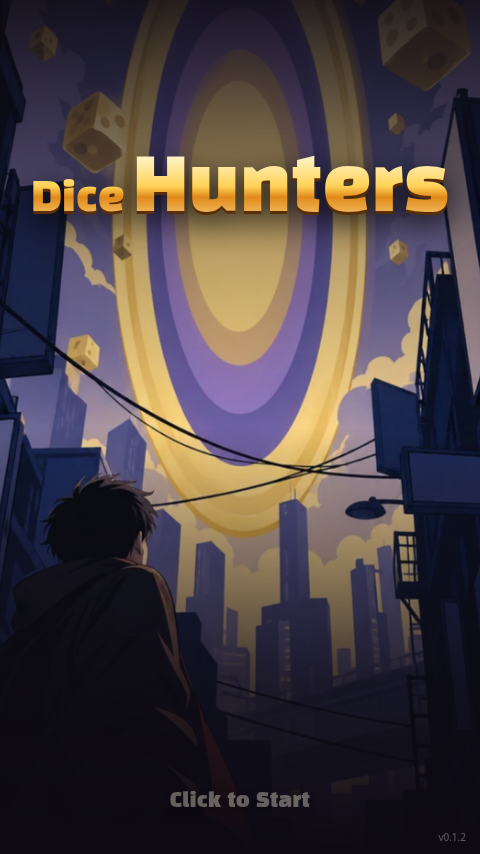
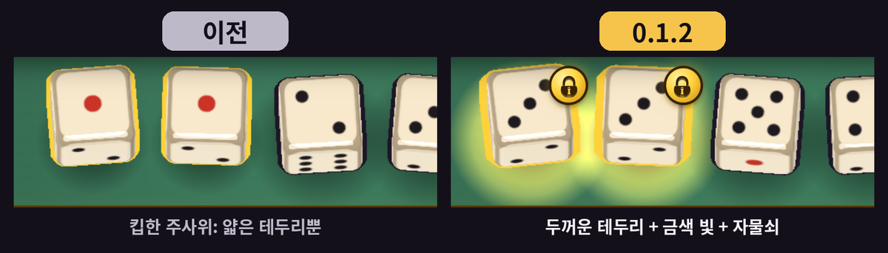
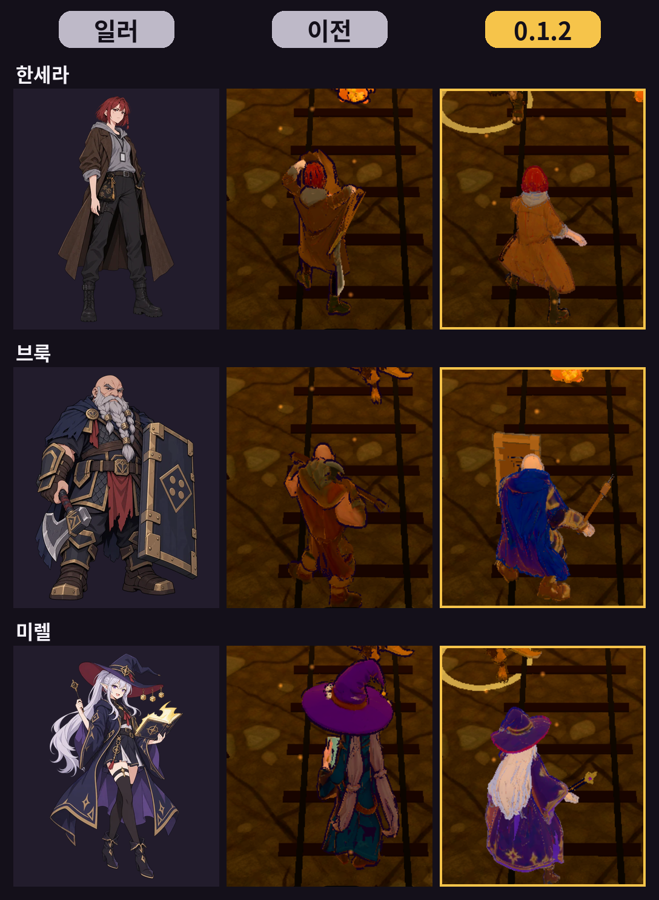
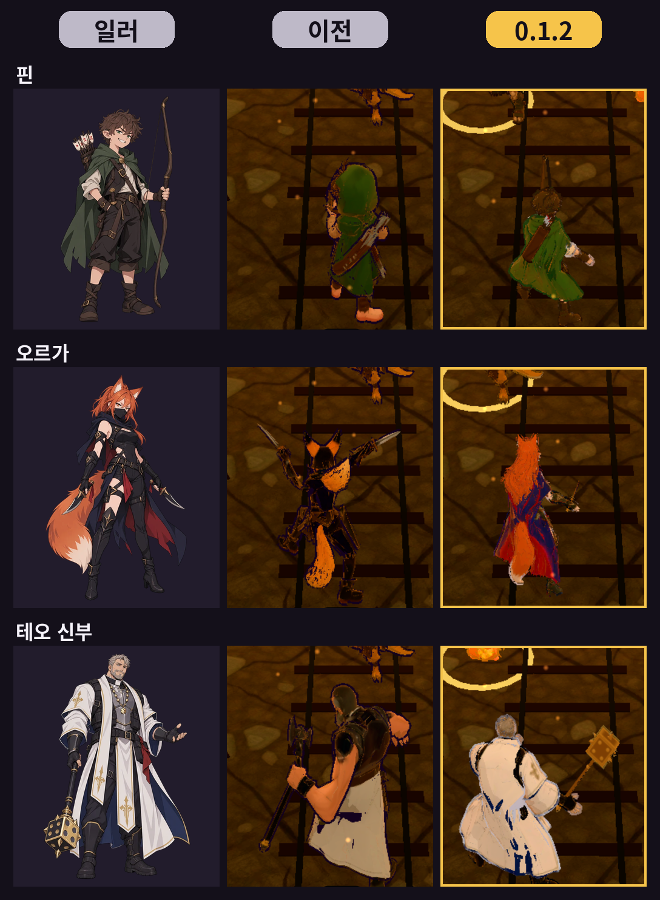
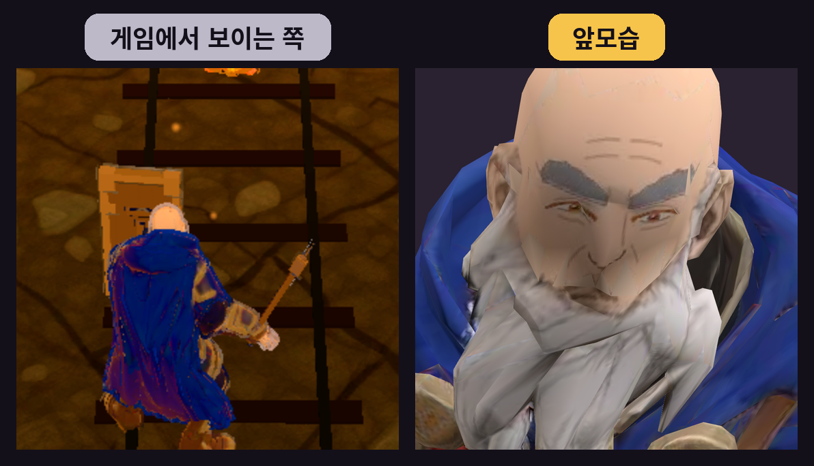

Dice Hunters 0.1.2가 나왔다. 밸런스는 바꾸지 않았다. 커뮤니티 댓글에서 나온 의견을 반영했다.

## 킵한 주사위와 조작

킵한 주사위가 잘 안 보인다는 의견이 있었다. 두꺼운 테두리, 금색 빛, 자물쇠 아이콘을 넣어 고정한 주사위가 바로 보이게 했다.

버튼은 눌린 모습과 소리를 넣어 눌렀을 때 반응이 있게 했다. 주사위를 굴리면 진동이 난다. 진동은 Android에서만 난다.

## 영웅 모델

모델이 일러스트와 다르다는 의견이 있어서, 여섯 영웅 모델을 Meshy로 다시 만들었다. Sera Hunter, Brook Tank, Mirel Mage, Fin Archer, Orga Rogue, Father Teo Priest다. 어두운 막에서도 보이도록 밝기도 올렸다.

왼쪽부터 일러스트, 이전 모델, 0.1.2 모델이다.

얼굴은 다소 거칠다. 전투에서는 등만 보이므로 그대로 두었다.

## 전투 로딩

전투에 쓸 모델은 지도나 허브에 있는 동안 미리 받아 둔다. 느린 모바일 회선(Slow 4G)에서, 전투에 들어가 캐릭터가 보이기까지 18.8초 걸리던 시간이 2.2초로 줄었다. 아직 받는 중이면 불러오는 중 표시가 나온다.

## 카드 드래그

카드를 끌다가 포인터가 카드 밖으로 나가면 드래그가 끊기던 문제를 고쳤다. 드래그 중에 다른 앱으로 전환했다가 돌아와도 카드가 걸린 채로 남지 않는다. 저장과 로딩의 자잘한 버그도 같이 고쳤다.

게임을 다듬는 데 쓰려고 익명 통계를 보낸다. 설정의 익명 통계에서 끌 수 있다.

## 어떻게 만들었나

고칠 항목은 내가 정했다. Grok Bot이 일을 나누고, Codex에게 코딩을 맡기고, 확인과 테스트까지 처리했다. 개발은 대부분 밖에 있을 때 휴대폰으로 했다.

- [게임](https://yhkk.itch.io/dice-hunters)
- [0.1.2 devlog](https://yhkk.itch.io/dice-hunters/devlog/1748986/012-012-update-new-hero-models-faster-loading-card-drag-fix)
- [프로젝트 페이지](/ko/projects/dice-hunters)
