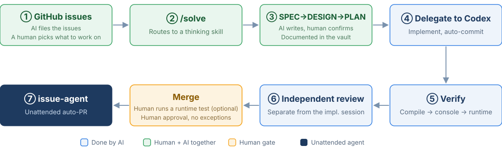
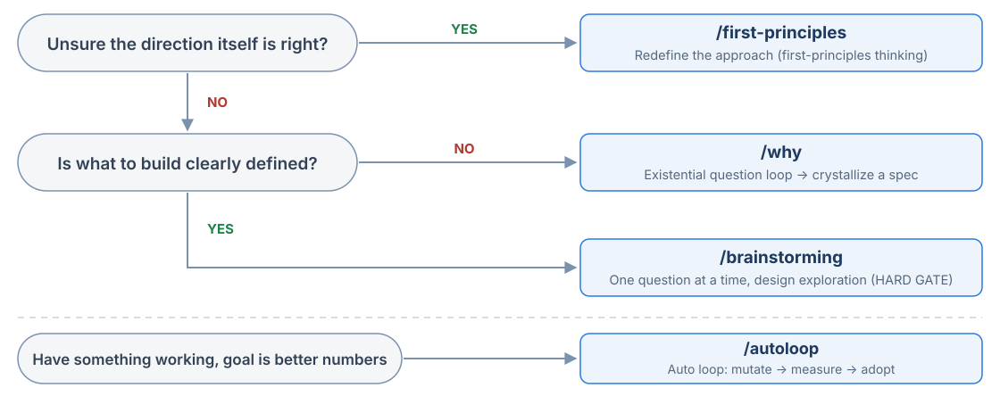
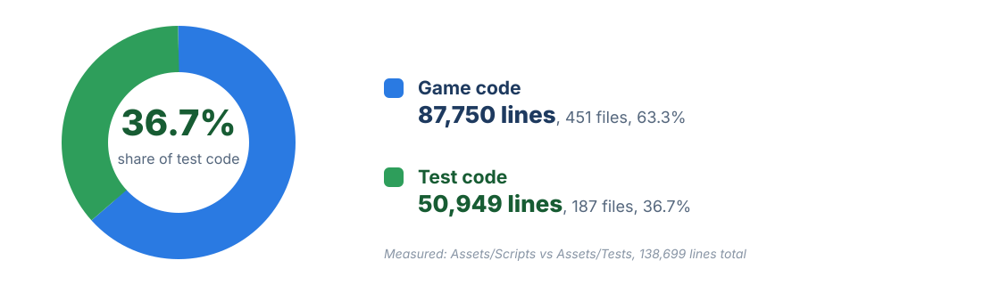
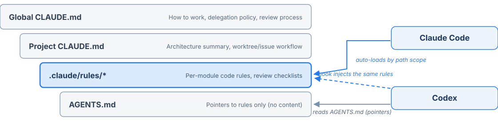
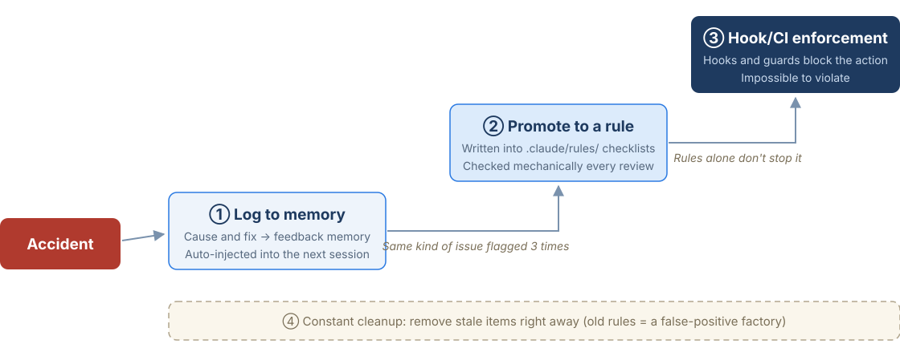

<!-- _class: title -->
<!-- _paginate: false -->

# Agentic Dev Workflow

## Building a Game with One Human and Several AIs

The issue → spec → implementation → review → auto-PR pipeline
behind a Unity 2D turn-based tactics RPG side project

**KineticKeeper**, 2026-07

---

###### Intro

# Background: the bottleneck is human time

- A **solo side project** run alongside a day job at a game company: Unity 6, 2D turn-based tactics RPG
- **Trial and error to experience an agentic project I can't pursue at work.** This talk is the record
- Coding time itself is scarce, and the hours I can spare vary day to day
- Common failure patterns in AI-assisted development:
  - The same mistakes **repeat every session** (context evaporates)
  - It does only what you asked, or more than you asked (scope control fails)
  - It says "done," but it doesn't actually work (no verification)

**The frame of this talk:**

## Don't just "make" the AI work. **Build a system the AI can work in**

---

###### Intro

# The whole pipeline: today's map



- Each chapter that follows **zooms into one section** of this diagram
- Act 1: Following the pipeline (①~⑥)
- Act 2: Going unattended (⑦)
- Act 3: **Why** it keeps running, and **how** it stays that way

---

<!-- _class: divider -->

# Act 1: Following the Pipeline

## From filing an issue to a ready PR (①~⑥)

---

<!-- _class: compact -->

###### Act 1, Pipeline ①

# Issue infrastructure: a TODO list machines can read

- **GitHub issues = the single TODO tracker**: bugs to fix now, milestone-sized specs, review suggestions, all of it
- **One `area:*` + one `type:*` label** (no priority labels). Clean labels = **machines can pick issues too** (→ Act 2)
- **Two worktrees in parallel**: `epoch` (new work) / `epoch-issues` (bugs, debt) → two AI sessions at once

<div class="gh">
<p>Battle: UIEnemyHUD HP bar keeps the predicted damage (red gauge) after auto-delegate picks an action <i class="lb a">area:battle</i> <i class="lb t">type:bug</i><small>#657 by me was closed 1w ago</small></p>
<p>Battle: camera doesn't focus the target unit on turn-start poison/terrain tick damage <i class="lb a">area:battle</i> <i class="lb t">type:bug</i><small>#652 by me was closed 1w ago</small></p>
<p>weekly code review: my-game 4bd03de..9f0fb9c <i class="lb n">weekly-review</i><small>#649 by me was closed 20h ago</small></p>
<p>[review] Pointer cancel now ends the turn even when the click is off-grid <i class="lb n">auto-review</i> <i class="lb t">type:bug</i><small>#648 by me was closed 5d ago</small></p>
<p>[review] PrepareHub load failure discards the current hub session <i class="lb n">auto-review</i> <i class="lb t">type:bug</i><small>#646 by me was closed 1w ago</small></p>
<p>[review] Unit animation enum rename breaks existing UnitAnimationData assets <i class="lb n">auto-review</i> <i class="lb t">type:bug</i><small>#645 by me was closed 1w ago</small></p>
<p>Shop: no validation for sell row prefab registration (LoopListView2 ItemPrefabDataList) <i class="lb a">area:outgame</i> <i class="lb x">type:test</i><small>#641 by me was closed 2d ago</small></p>
</div>

---

<!-- _class: compact -->

###### Act 1, Pipeline ②

# /solve: the entry router

Got a problem but no idea where to start? **A 30-second triage routes it to a thinking skill**



- The point: **kill the cost of "which skill do I use?"** With 30+ skills and no router, the human is the bottleneck

---

###### Act 1, Pipeline ②

# The four thinking skills it routes to: origins and differences

| Skill | Origin | What it does |
|---|---|---|
| `/first-principles` | Elon Musk's **first-principles thinking** | Strips away assumptions and conventions and rebuilds the approach from fundamental truths. Hits "why does everyone do it this way?" head on |
| `/why` | Derived from `/grill-me` (adversarial grilling): **Socratic specification** | An existential question loop ("why should this exist?") that crystallizes a vague idea into a validated spec |
| `/brainstorming` | Ported from the **superpowers** skill set (open source) | One question at a time, plus 2 or 3 candidate approaches. No implementation before approval: a **HARD GATE**, "no exceptions, even if it looks simple" |
| `/autoloop` | Karpathy's **autoresearch** pattern | Takes a working result and automatically repeats mutate → measure → adopt against an evaluation metric |

In one line: **first-principles breaks "the approach itself," why digs into "the reason to exist," brainstorming shapes "what's decided" into a design, and autoloop tightens "what works" by the numbers**

---

###### Act 1, Pipeline ③-1

# SPEC: if these 4 aren't filled in, we don't start

`/plan-spec`: collects and validates **4 required items** interactively before implementation

| Required item | Why it matters |
|---|---|
| Feature description | If you can't write what you're building in one sentence, you don't know yet |
| Implementation details | Blocks the AI's "I'll fill it in myself" up front |
| Constraints | Spell out what must not be touched (scope control) |
| **Done criteria** | In a **verifiable form**: /verify later checks against this automatically |

- Output: vault `features/{YYMMDD}-{feature-name}/1-SPEC-*.md`, kept in **Obsidian**, not the repo
- Branch by size: medium/large → deeper DESIGN; small (only if all 4 conditions are met) → straight to PLAN
  - The default is **going through DESIGN** (a conservative branch: skipping is the exception)

---

###### Act 1, Pipeline ③-2

# DESIGN: pin decisions down in a document

`/plan-design`: an 8-step design deep dive. **Unneeded steps are skipped**

```text
Feasibility → Tech stack → User flow → Screens → API → Data → Architecture → Tech decisions
```

- What matters here: **leaving the "decisions" behind**
  - AI sessions get thrown away. Even when the next session or a different AI arrives, **decisions in a document don't waver**
  - Record even "why option B and not A" → when a review pushes back later, there's no re-arguing
- Output: `2-DESIGN-*.md` in the same folder

A real example (vault `features/` folder):

```text
260620-balance-sim-harness/
  ├── 2-DESIGN-balance-sim-harness.md
  ├── 3-PLAN-balance-sim-harness-01-core-stats.md
  └── 3-PLAN-balance-sim-harness-02-...
```

---

###### Act 1, Pipeline ③-3

# PLAN: leave the executor no room for judgment

`/writing-plans`: the implementation plan. **It's executed by another AI (Codex), not a human**

- Split responsibilities per file → **bite-sized 2 to 5 minute steps** → code, commands, expected results **fully spelled out**
- What matters here: **ambiguity = where the executor gets creative = where accidents happen**
  - If a phrase like "handle appropriately" is still there, the plan isn't finished
  - Every step also states how to verify it (compile, tests, grep)

**Why the stages are split is the key:**

| Stage | Output | Gate question |
|---|---|---|
| SPEC | 1-SPEC | "What, and when do we call it done?" |
| DESIGN | 2-DESIGN | "What structure, and why that structure?" |
| PLAN | 3-PLAN | "Can the executor follow it without judgment calls?" |

---

###### Act 1, Pipeline ④-1

# Division of roles: a three-party setup

| Agent | Owns | Rationale |
|---|---|---|
| **Claude** | Orchestrator: planning, git, issue/PR management, docs, delegation briefs | The hub of context. The only one that knows the whole picture |
| **Codex** | **All code**: implementation, fixes, refactoring, debugging, exploration, review | Even a one-line `.cs` change is delegated, no exceptions |
| **agy** (Antigravity) | Scenario writing: talks with the user directly | Creative work is the back-and-forth itself, so relaying it loses something |

- **"Anything that touches code goes to Codex"**: the point is that the rule has no exceptions
  - The moment "it's a small change, I'll just do it" slips in, the whole role split collapses (this was actually called out once and logged as a rule)
- A side effect of the split: the implementer (Codex) and the manager (Claude) **don't mix contexts** → the foundation for independent review (continued in ⑥)

---

###### Act 1, Pipeline ④-2

# Codex 4-tier: not every task gets the top model

| Tier | Model/effort | Use |
|---|---|---|
| A | gpt-5.5 + xhigh | Architecture, large refactors, security audits, long-horizon debugging |
| **B ⭐default** | gpt-5.5 + high | General implementation, fixes, plan-based work |
| C | gpt-5.4 + xhigh | One-off deep analysis and algorithms (not long-horizon) |
| D | gpt-5.4 + high | **Fixed for code review**, exploration, lint, docs, research |

- Everything on the top tier means **about 2x the unit cost and high latency**. The task type picks the tier
- Why review is D: many wide, shallow passes beat one deep pass on value
- Delegation briefs always carry pitfall clauses (e.g. "no new interfaces or public APIs," "check Unity assets via unity-cli"), each one born from a past accident (setup for Act 3)

---

<!-- _class: compact -->

###### Act 1, Pipeline ⑤

# Verification: the AI verifies its own changes

**DoD: compile → console errors → one runtime pass per module** (battle = advance a turn, UI = open and close the screen, …all in the rules)

- **unity-cli-bridge**: an external CLI drives the *running Editor*: compile, console, tests, ad hoc C#, asset queries
- **Sandbox launcher**: skips save/navigation and jumps straight into battle for smoke tests. **Not dumped on the human**
- **The human's part is defined too**: every completion report ends with "launch this, check that" runtime steps

<div class="duo-t"><pre class="term" data-title="claude: ~/dev/my-game"><i class=hl>❯ Run the test yourself and verify it</i>
● Sure, I'll drive it all the way into battle and verify enemy AI movement myself. Checking the Editor state first.
  <i>Ran 1 shell command</i>
● Not in PlayMode (System.unity). Entering PlayMode and waiting for the reconnect.
<i class=g>●</i> Background command "Poll for bridge reconnect after PlayMode" completed (exit code 0)
● Title screen. Checking save slots via Continue (LoadButton).
● Slot 1 is camp (sortie prep). Sortie prep → battle prep → deploy → start battle.
● An empty-slot confirm popup appeared. Pressing Yes to start the battle.
<b>● Running 1 shell command…</b>
  ⎿ <b>$ U=~/.unity-cli-bridge/unity-cli/unity-cli</b>
    <b>P=~/dev/my-game/UnityProject</b>
    <b>"$U" qa click --target "/[BattleUICanvas]/UIYesNoPopup(Clone)/Root/ButtonGroup/YesButton" --project "$P" --json --output compact</b>
<i class=o>✻ Spelunking… (2m 21s | ↓ 6.7k tokens | thinking with xhigh effort)</i></pre><pre class="term" data-title="Unity Console"><i>[09:22:45]</i> <i class=cy>[Navigation] Replace (Dispose): TitleScreen</i>
<i>[09:23:02]</i> <i class=cy>[Navigation] Push: PrepareHubSortieScreen (Stack: 2)</i>
<i>[09:23:02]</i> <i class=cy>[Navigation] Clear (Count: 2)</i>
<i>[09:23:02]</i> Scanned graphs in 27 ms
<i>[09:23:02]</i> <i class=g>[CinemachineCameraController] Confiner setup complete</i>
<i>[09:23:02]</i> [BattleRng] seed=1876936875 (override=False)
<i>[09:23:26]</i> [BattleWeather] WeatherChanged Clear -> Cloudy
<i>[09:23:29]</i> [QADBG] phase=PlayerTurn detect=True selPos=(13, 2)
           P Erich pos=(13, 2) hp=100/100</pre></div>

> Unity Editor game view at this point: BattleScene loaded, waiting on the player turn (capture omitted)

---

<!-- _class: compact -->

###### Act 1, Pipeline ⑥

# Review: implementation session ≠ review session

**Flow: work done → local Codex diff review (P1/P2/P3 + file/line + cause + recommendation) → apply → ready PR**

- **Implementation session ≠ review session**: same reasoning = same blind spots (confirmation bias). Review always runs in a **fresh session**; an implementing session saying "I reviewed it too" doesn't count. Same idea as "no self-approval" on human teams
- Dropped the GitHub review bot (misses, shallow findings) → local review by default, adversarial multi-agent review opt-in for big changes

<pre class="term" data-title="claude: ~/dev/my-game">● Review complete (fresh session, Tier D). Results:
<b>codex review findings</b>
- <b>P1:</b> none
- <b>P2 (line 153, case B):</b> the same-type overwrite test checks only <b>GUID</b> and name → it still passes if the code regresses from <i class=l>CopySerialized</i> (keeps the instance) to "delete and recreate." The <i class=l>CreateAsset</i> path measured in case C keeps the GUID too, so this is correct. GUID alone doesn't pin the CopySerialized path.
  - Fix: <i class=l>Assert.AreSame</i> on the <i class=l>existing</i> instance loaded before overwrite vs the asset after → proves identity directly
- <b>P3 (line 48):</b> coupled to the real game type <i class=l>BattleConfigData</i> → an unrelated rename/removal can break the fixture. Use a dummy <i class=l>ScriptableObject</i> in the test
- <b>P3 (line 29):</b> assembly lookup in a static initializer + <i class=l>First()</i> → if missing, a <i class=l>TypeInitializationException</i> fires before the <i class=l>SetUp</i> assert and hides the cause. Use <i class=l>FirstOrDefault</i> + an explicit SetUp failure
<b>My call</b>
<b>P2 is right to apply</b>: this test exists to "pin the overwrite branch," but GUID alone misses a CopySerialized regression. Checking instance identity with <i class=l>AreSame</i> actually pins it. The two P3s cut coupling and improve diagnostics, so apply them too (type:test, no production impact).
<b>I'll delegate all 3 findings to codex → re-verify → open the PR. Go ahead?</b></pre>

---

<!-- _class: divider -->

# Act 2: Going Unattended

## PRs that show up while you sleep (⑦)

---

###### Act 2, Unattended ⑦-1

# issue-agent: PRs show up while you sleep

An **unattended agent** running on a Mac mini picks up an issue → branches → fixes → verifies → **opens a PR automatically**

The policy is declared **as code** in the repo's `.issue-agent.yml`:

```yaml
auto_eligible_labels: [type:cleanup, type:bug, type:tech-debt]
exclude_labels: [type:feature]        # skip anything that needs a design call
max_diff_lines: 60                    # small fixes only
require_repro_test: true              # no repro test, no PR
verify:
  type: unity
  commands: [refresh, console]        # verify compile and console on local Unity
```

- **Paying off Act 1's setup**: because the `type:*` label convention is clean, the machine can tell which work is "OK to pick up"
- Why features are excluded: a new feature = a design decision = human territory

---

###### Act 2, Unattended ⑦-2

# The real thing: what happened while I slept

<div class="pair"><div class="pr"><h4>fix(issue-agent): #702 fix missing ailment duration tick for Ally on the player turn <i>#713</i></h4><p><b class="op">Open</b> <b>issue-agent</b> wants to merge 1 commit into <code>master</code> from <code>fix/issue-702</code></p><div class="cm"><b>issue-agent <i>commented 8 hours ago</i></b><p>Closes <a>#702</a></p><p>[auto-issue-agent dry-run]</p><ul><li>Summary: ProcessTurnStartPhaseBase.TickAilmentDurations() now also iterates BattleTeam.Ally on the Player turn-start cadence (same pattern as barrier/endure/auto-consumable/support-charge). Fixes Ally NPC ailment durations never counting down.</li><li>Lines changed: 11+/1-</li><li>Compile errors: 0 (unity-cli read-console)</li><li>Repro test: skipped (a new test file + .meta risked going over the 60-line cap, Codex's call)</li></ul><p>🤖 auto-issue-agent (Phase 0 dry-run)</p></div><p class="cr">fix(issue-agent): #702 tick ally ailment durations <i>1f8f26b</i></p></div><div class="dc"><p class="day">July 4, 2026</p><p class="who"><b>DEV</b><i>APP</i><s>Yesterday at 3:21 AM</s></p><p>🌙 issue-agent | my-game | 03:21</p><p>Went through 23 issues and opened 1 PR (#619: range overlay border texture now injected explicitly instead of a raw Resources.Load).<br>#647 got done, but the diff hit 84 lines (46+/38-), over the 60-line policy cap, so I stopped. Codex went past a minimal fix and removed a helper and restructured the evaluation loop. Tagged it needs-human and only pushed the fix to origin/fix/issue-647 (commit 8ceaf332), so a human can check the size and decide whether to open a PR.<br>(Note: the local #647 WIP left on fix/issue-647 at start is preserved non-destructively in stash@{0}.)</p><p>- #619: <u>my-game#701</u><br>- #647: abort, diff 84 lines &gt; 60 cap, needs-human (commit 8ceaf332 pushed, no PR)</p><p>Result: PR 1 / fail 0 / abort 1, triage eligible 2, skip 21<br>fetched=23 (inflight 1, untestable 19, toobig 1, exclude 0)</p></div></div>

**Left**: a real PR opened by issue-agent: Closes #N, with a change summary and even 0 compile errors, all self-reported
**Right**: a Discord notification at 3:21 a.m.: 23 issues triaged → 1 PR. **The issue aborted for exceeding the 60-line cap** was handed to a human (needs-human): the moment the guardrails on the next slide actually kicked in

---

###### Act 2, Unattended ⑦-3

# Guardrails for going unattended: more autonomy ⇒ more guardrails

```yaml
auto_merge:
  enabled: false                          # merging is always a human
  forbid_paths: [Tests/, .github/, CODEOWNERS]
notify:
  on_failure: true
```

- **Auto-merge off**: the agent only goes as far as the PR. Final approval is human
- **No edits to `Tests/` = defense against test gaming**
  - The classic failure mode, an agent passing by "fixing the tests," is sealed off by blocking the path
- No `.github/` or CODEOWNERS = **the agent can't edit its own guardrails**
- `require_repro_test`: a bug fix must come with a repro test (forces proof of the fix)

**Lesson: every time autonomy goes up a step, the guardrails go up a step too.**
Human-reviewed PRs and unattended PRs earn different levels of trust, and the policy absorbs that gap

---

<!-- _class: divider -->

# Act 3: Why It Runs, and How It Stays That Way

## Conventions, context injection, and the mistake-logging loop

---

<!-- _class: compact -->

###### Act 3, Why it runs ①

# AI-friendly conventions (runtime): rules you can grep

**AI-friendly down to the genre**: a deterministic turn-based SRPG, so outside UI/UX the AI can **always reproduce** almost anything
→ same seed = same battle → the basis for replays, skip parity, and auto balance sims (the autoloop milestone)

On top of that, good conventions for humans ≈ good conventions for AI. The difference: **AI follows mechanically checkable rules well**

| Rule | Effect from the AI's side |
|---|---|
| Dependencies via ServiceLocator, no direct singleton refs | One `grep` catches violations → automatable review |
| Randomness only via `RandomUtil` (separate logic/visual channels) | Search `UnityEngine.Random` = instant violation check. Protects seed replay (replays, sims) |
| Missing refs and unset values **fail loudly with a log, right away** | The AI sees problems from the console alone. It can't catch silent failures |
| Each responsibility lives at one boundary only | One place to fix → "where do I change this?" gets cheap |
| Don't mix Task flows with Coroutine flows | Shrinks the search space for async bugs |

- **Boundary rules** (e.g. "don't patch in code what design should solve") curb the AI's overeagerness (unasked-for defensive code)

---

###### Act 3, Why it runs ②

# Codebase makeup: 37% of all code is tests



**An unusual share for a game project**: the games industry has traditionally been light on test code. Here, tests are **how the AI proves its own changes**, and the marginal cost of writing them is low (the AI writes them), so a culture of attaching a repro test to every bug fix holds → next slide: the rules that hold this pile of tests up

---

###### Act 3, Why it runs ③

# AI-friendly conventions (tests): the AI's means of self-verification

Tests are the tool the AI uses to prove its own changes → **the rules pin down "how far the AI can verify"**

- **Codify the EditMode/PlayMode boundary**: pure logic = EditMode, scene and phase routing = PlayMode/runtime
  - Without that boundary, accidents happen where the AI reports "untestable" as if it were "tests pass"
- **When behavior changes, grep every test that asserts the old behavior**: AI tends to update only tests near the code it touched
- **Before removing a public API, grep its consumers including `Tests/`**: reflection-based tests compile fine and only break at runtime
- **"No errors" ≠ "it works"**: the code path may never have run because there was no data. Confirm it actually triggers with real data

What these have in common: **every one of them actually bit us at least once** (→ next chapter)

---

<!-- _class: compact -->

###### Act 3, Why it runs ④

# 3-layer context injection: where a rule lives decides compliance



- **Single source of truth**: never write the same rule in two places. AGENTS.md holds only pointers, no content
- **For Codex, a hook injects the same rules**: `claude-rules-bridge` loads the rules matching the paths a tool call touches, on the spot → **same rules, one set of files.** Edit a rule and both sides get it
- **Code in the repo, docs in an Obsidian vault**: planning and SPEC/DESIGN/PLAN all live in the vault, and **Syncthing keeps MacBook (human gate) ↔ Mac mini (unattended agent) in sync**, so either side's agents see the latest docs
- **Automatic cross-session memory**: facts and lessons pile up in files and auto-load into the next session

---

###### Act 3, How it stays ①

# The mistake-logging loop: the core of this talk

**"AI repeats the same mistakes"** → a 4-rung ladder that blocks repeats by design:



The point: **don't climb the whole ladder**. Most stop at ①; only repeat offenders move up to ② and ③

---

###### Act 3, How it stays ②

# Real cases: every rule you've seen came from an accident

| Accident | What got logged | Rung |
|---|---|---|
| Delegated auto-commits landed 7 commits directly on master | "Branch before delegating" rule | ② |
| `git checkout <ref> -- .` wiped all user changes | Command banned; single files via `git show` | ① |
| Implementing session reviewed itself → a fake review | "Implementation ≠ review session" rule (see ⑥) | ② |
| Editor refresh overwrote an uncommitted prefab | Commit/stash isolation step before delegating | ① |
| Guessed and edited the wrong component → whole PR scrapped | "Use the spec's component name verbatim" rule | ② |
| Broken tool-call format (model-level error) | **Stop hook blocks and retries**: can't be broken | ③ |
| Risk of test gaming by the unattended agent | `forbid_paths: [Tests/]`: path block (see Act 2) | ③ |

- ④-2's standing brief clauses, ⑦-3's guardrails: **all products of this loop**
- Tools can be copied, but **this logging loop is what makes the workflow sustainable**

---

<!-- _class: divider -->

# Closing

## Limits, the human's part, and what to take home

---

###### Closing

# Limits and the human's part

**What humans still do, and what humans should keep doing:**

- **Design decisions**: the AI goes as far as recommendations and reasons; the decision is human. Even two AIs agreeing isn't a mandate
- **Fine-tuning UI visual design**: layout, color, spacing. The AI handles structure and conventions only
- **Final merge approval**: no exceptions, whether the PR came from a human or an unattended agent
- **Deciding which review findings to accept**: review comments are information, not orders
- **First detection of an accident**: the loop automates the logging, not the detecting

**Current limits:**

- The unattended agent handles small fixes of 60 lines or fewer. Work that needs judgment can't be handed over yet
- Verifying runtime "feel" (hit impact, presentation quality) still comes down to human eyes
- Pipeline upkeep: rules, memory, and docs need constant gardening (left alone, they turn into a false-positive factory)

---

###### Closing

# Wrap-up


**Three things to take home:**

1. **A pipeline, not a tool**: every stage needs an output and a gate, or the AI runs wild
2. **Independence and self-verification create quality**: separate implementation and review sessions, and let the AI drive its own changes
3. **Log your failures into the system**: the memory → rule → machine-enforcement ladder. Without it, everything else is an expensive toy that repeats the same accidents

---

<!-- _class: title -->
<!-- _paginate: false -->

# Q&A
