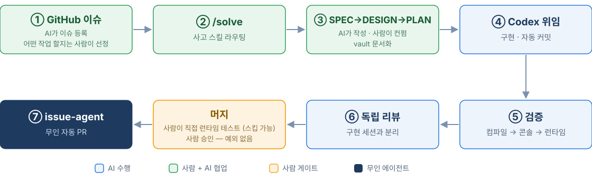
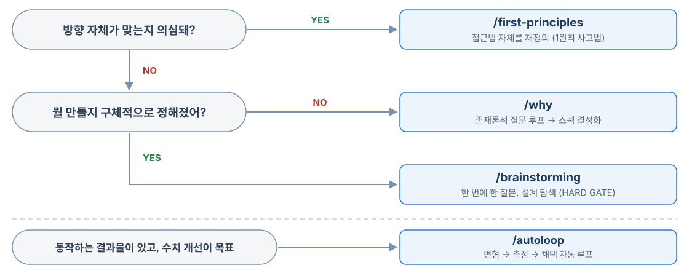
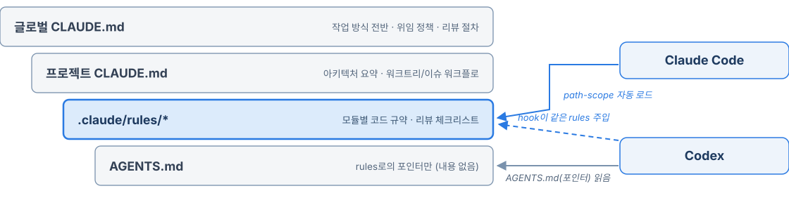
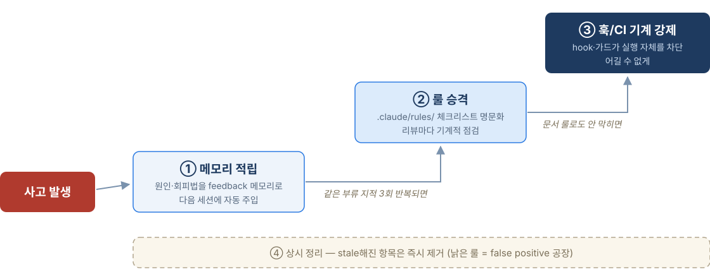

<!-- _class: title -->
<!-- _paginate: false -->

# 에이전틱 개발 워크플로

## 사람 1명 + AI 여러 대로 게임 만들기

Unity 2D 턴제 전술 RPG 사이드 프로젝트의
이슈 → 스펙 → 구현 → 리뷰 → 자동 PR 파이프라인

**KineticKeeper**, 2026-07

---

###### 인트로

# 배경 — 병목은 사람의 시간

- 본업(게임회사) 병행 **1인 사이드 프로젝트** — Unity 6, 2D 턴제 전술 RPG
- **회사에서는 추구하지 못하는 에이전틱 프로젝트를 경험하기 위한 삽질들** — 이 발표는 그 기록
- 코딩 시간 자체가 희소 자원. 하루에 낼 수 있는 시간이 들쭉날쭉
- AI 보조 개발의 흔한 실패 패턴:
  - 같은 실수를 **매 세션 반복** (컨텍스트가 휘발)
  - 시킨 것만 하거나, 안 시킨 것까지 함 (범위 통제 실패)
  - "됐다"고 하는데 실제로 안 됨 (검증 부재)

**이 발표의 프레임:**

## AI에게 일을 "시키는" 게 아니라, **AI가 일할 수 있는 시스템을 만든다**

---

###### 인트로

# 전체 파이프라인 — 오늘의 지도



- 앞으로 각 챕터가 이 그림의 **한 구간을 확대**합니다
- 1막: 파이프라인 따라가기 (①~⑥)
- 2막: 무인화 (⑦)
- 3막: 이게 **왜** 굴러가고, **어떻게** 유지되는가

---

<!-- _class: divider -->

# 1막 — 파이프라인 따라가기

## 이슈 등록부터 ready PR까지 (①~⑥)

---

###### 1막 · 파이프라인 ①

# 이슈 인프라 — 기계가 읽을 수 있는 TODO

- **GitHub issue = 단일 TODO 트래커** — 지금 손댈 버그부터 마일스톤급 스펙, 리뷰 발 제안까지 전부
- **라벨은 `area:*` 하나 + `type:*` 하나** (우선순위 라벨 없음) — 정리된 라벨 = **기계도 이슈를 집는다** (→ 2막)
- **워크트리 2개 병렬 운용** — `epoch`(신규 개발) / `epoch-issues`(버그·부채) → AI 세션 2개 동시 가동

<div class="gh">
<p>전투: 자동위임 행동 선택 시 UIEnemyHUD 체력바 예상피해(빨간 게이지) 잔존 <i class="lb a">area:battle</i> <i class="lb t">type:bug</i><small>#657 by me was closed 1w ago</small></p>
<p>전투 턴 시작 독/지형 틱 데미지 시 대상 유닛 카메라 미포커싱 <i class="lb a">area:battle</i> <i class="lb t">type:bug</i><small>#652 by me was closed 1w ago</small></p>
<p>weekly code review: my-game 4bd03de..9f0fb9c <i class="lb n">weekly-review</i><small>#649 by me was closed 20h ago</small></p>
<p>[review] Pointer cancel now ends the turn even when the click is off-grid <i class="lb n">auto-review</i> <i class="lb t">type:bug</i><small>#648 by me was closed 5d ago</small></p>
<p>[review] PrepareHub load failure discards the current hub session <i class="lb n">auto-review</i> <i class="lb t">type:bug</i><small>#646 by me was closed 1w ago</small></p>
<p>[review] Unit animation enum rename breaks existing UnitAnimationData assets <i class="lb n">auto-review</i> <i class="lb t">type:bug</i><small>#645 by me was closed 1w ago</small></p>
<p>상점 sell row prefab 등록 검증 공백 (LoopListView2 ItemPrefabDataList) <i class="lb a">area:outgame</i> <i class="lb x">type:test</i><small>#641 by me was closed 2d ago</small></p>
</div>

---

###### 1막 · 파이프라인 ②

# /solve — 진입 라우터

문제는 있는데 어디서부터 시작할지 모를 때, **30초 triage로 사고 스킬에 라우팅**



- 포인트: **"어떤 스킬을 쓸지 고민하는 비용" 자체를 제거** — 스킬 30개+에서 라우터 없으면 사람이 병목

---

###### 1막 · 파이프라인 ②

# 라우팅 대상 사고 스킬 4종 — 기원과 차이

| 스킬 | 기원 | 하는 일 |
|---|---|---|
| `/first-principles` | 일론 머스크의 **1원칙 사고법** | 가정·관습을 벗겨내고 근본 진실에서 접근법을 재구축. "왜 다들 이렇게 하지?"를 정면으로 침 |
| `/why` | `/grill-me`(적대적 추궁)에서 파생 — **Socratic specification** | 존재론적 질문 루프("이게 왜 존재해야 하나")로 막연한 아이디어를 검증된 스펙으로 결정화 |
| `/brainstorming` | **superpowers** 스킬셋(오픈소스)에서 이식 | 한 번에 한 질문 + 접근안 2~3개 제시. 승인 전 구현 금지 **HARD GATE** — "단순해 보여도 예외 없음" |
| `/autoloop` | Karpathy **autoresearch** 패턴 | 동작하는 결과물을 평가 지표 기준으로 변형→측정→채택 자동 반복 |

한 줄 구분: **first-principles는 "접근 자체"를 부수고, why는 "존재 이유"를 캐고,
brainstorming은 "정해진 것"을 설계로 다듬고, autoloop는 "되는 것"을 수치로 조인다**

---

###### 1막 · 파이프라인 ③-1

# SPEC — 4가지를 못 채우면 시작하지 않는다

`/plan-spec`: 구현 전에 **4필수 명세**를 대화형으로 수집·검증

| 필수 항목 | 왜 중요한가 |
|---|---|
| 기능 설명 | 뭘 만드는지 한 문장으로 못 쓰면 아직 모르는 것 |
| 구현 디테일 | AI의 "알아서 채움"을 사전에 차단 |
| 제약 조건 | 건드리면 안 되는 것 명시 (범위 통제) |
| **완료 기준** | **검증 가능한 형태**로 — 나중에 /verify가 이걸 자동 대조 |

- 산출물: vault `features/{YYMMDD}-{기능명}/1-SPEC-*.md` — repo가 아니라 **Obsidian**에
- 규모 판정 후 분기: 중대형 → DESIGN 심화 / 소형(4조건 전부 충족 시만) → PLAN 직행
  - 기본값은 **DESIGN 경유** (보수적 분기 — 건너뛰기가 예외)

---

###### 1막 · 파이프라인 ③-2

# DESIGN — 결정을 문서로 고정한다

`/plan-design`: 8단계 설계 심화. **불필요한 단계는 스킵**

```text
구현 가능성 → 기술 스택 → 사용 흐름 → 화면 → API → 데이터 → 아키텍처 → 기술 결정
```

- 여기서 중요하게 보는 것: **"결정"을 남기는 것**
  - AI 세션은 갈아치워진다. 다음 세션·다른 AI가 와도 **결정이 문서에 있으면 흔들리지 않음**
  - "왜 A안이 아니라 B안인가"까지 기록 → 나중에 리뷰가 반박해도 재논쟁 안 함
- 산출물: 같은 폴더에 `2-DESIGN-*.md`

실제 예시 (vault `features/` 폴더):

```text
260620-balance-sim-harness/
  ├── 2-DESIGN-balance-sim-harness.md
  ├── 3-PLAN-balance-sim-harness-01-core-stats.md
  └── 3-PLAN-balance-sim-harness-02-...
```

---

###### 1막 · 파이프라인 ③-3

# PLAN — 실행자의 판단 여지를 없앤다

`/writing-plans`: 구현 계획 문서. **이 plan은 사람이 아니라 다른 AI(Codex)가 실행**

- 파일 단위 책임 분해 → **2~5분짜리 bite-sized 단계** → 코드/명령/예상 결과 **완전 명시**
- 여기서 중요하게 보는 것: **모호함 = 실행 AI의 창의성 발휘 지점 = 사고 지점**
  - "적절히 처리" 같은 문구가 남아 있으면 plan이 아직 안 끝난 것
  - 단계마다 검증 방법(컴파일·테스트·grep)까지 박음

**단계가 나뉜 이유가 핵심:**

| 단계 | 산출물 | 게이트 질문 |
|---|---|---|
| SPEC | 1-SPEC | "뭘, 언제 끝났다고 할 건가?" |
| DESIGN | 2-DESIGN | "어떤 구조로, 왜 그 구조인가?" |
| PLAN | 3-PLAN | "실행자가 판단 없이 따라갈 수 있는가?" |

---

###### 1막 · 파이프라인 ④-1

# 역할 분담 — 3자 체제

| 에이전트 | 담당 | 근거 |
|---|---|---|
| **Claude** | 오케스트레이터 — 기획·git·이슈/PR 관리·문서·위임 브리핑 | 컨텍스트의 허브. 전체 상황을 유일하게 다 앎 |
| **Codex** | **코드 전담** — 구현·수정·리팩토링·디버깅·탐색·리뷰 | `.cs` 1줄 수정도 예외 없이 위임 |
| **agy** (Antigravity) | 시나리오 창작 — 사용자와 직접 대화 | 창작은 왕복 대화가 본체라 중계하면 손실 |

- **"코드를 건드리는 일은 전부 Codex"** — 규칙에 예외를 안 두는 게 포인트
  - "작은 변경이니까 직접"이 무너지는 순간 역할 분리 전체가 무너짐 (실제로 1회 지적받고 룰로 적립)
- 역할 분리의 부수 효과: 구현자(Codex)와 관리자(Claude)의 **컨텍스트가 섞이지 않음**
  → 리뷰 독립성의 기반 (⑥에서 계속)

---

###### 1막 · 파이프라인 ④-2

# Codex 4-tier — 모든 작업에 최고 모델을 쓰지 않는다

| Tier | 모델/강도 | 용도 |
|---|---|---|
| A | gpt-5.5 + xhigh | 아키텍처, 대규모 리팩토링, 보안 감사, long-horizon 디버깅 |
| **B ⭐디폴트** | gpt-5.5 + high | 일반 구현·수정·plan 기반 작업 |
| C | gpt-5.4 + xhigh | 단발성 깊은 분석·알고리즘 (long-horizon 아님) |
| D | gpt-5.4 + high | **코드 리뷰 고정**, 탐색·린트·문서·리서치 |

- 전부 최상위 tier로 박으면: **단가 약 2배 + 지연 큼**. 작업 유형이 tier를 결정
- 리뷰가 D인 이유: 리뷰는 넓고 얕게 여러 번 도는 게 깊게 한 번보다 가성비가 좋았음
- 위임 브리핑에 함정 회피 조항을 상시 탑재 (예: "인터페이스/공개 API 추가 금지",
  "Unity 에셋 확인은 unity-cli로" — 전부 과거 사고에서 나온 문구, 3막 복선)

---

###### 1막 · 파이프라인 ⑤

# 검증 — AI가 자기 변경을 자기가 검증한다

**DoD: 컴파일 → 콘솔 에러 → 모듈별 런타임 1회** (전투=턴 진행, UI=화면 진입/복귀, …룰로 명문화)

- **unity-cli-bridge** — 외부 CLI가 *실행 중인 Editor*와 통신: 컴파일·콘솔·테스트·C# 즉석 실행·에셋 조회
- **샌드박스 런처** — 세이브/내비게이션 우회, 전투 씬 직행 스모킹테스트. **사람에게 떠넘기지 않음**
- **사람의 몫도 정의** — 완료 보고에 "무엇을 띄워 무엇을 확인하라" 런타임 검증 절차 항상 첨부

<div class="duo-t"><pre class="term" data-title="claude — ~/dev/my-game"><i class=hl>❯ 너가 직접 테스트 검증해줘</i>
● 네, 직접 전투까지 구동해서 적 AI 이동을 검증하겠습니다. 먼저 현재 Editor 상태를 봅니다.
  <i>Ran 1 shell command</i>
● PlayMode가 아닙니다(System.unity). PlayMode 진입 후 재연결을 기다립니다.
<i class=g>●</i> Background command "Poll for bridge reconnect after PlayMode" completed (exit code 0)
● 타이틀 화면입니다. 이어하기(LoadButton)로 세이브 슬롯을 확인합니다.
● 슬롯 1은 캠프(출진 준비)입니다. 출진 준비 → 전투 준비 → 배치 → 전투 시작.
● 빈 슬롯 확인 팝업이 떴습니다. Yes로 전투를 시작합니다.
<b>● Running 1 shell command…</b>
  ⎿ <b>$ U=~/.unity-cli-bridge/unity-cli/unity-cli</b>
    <b>P=~/dev/my-game/UnityProject</b>
    <b>"$U" qa click --target "/[BattleUICanvas]/UIYesNoPopup(Clone)/Root/ButtonGroup/YesButton" --project "$P" --json --output compact</b>
<i class=o>✻ Spelunking… (2m 21s · ↓ 6.7k tokens · thinking with xhigh effort)</i></pre><pre class="term" data-title="Unity Console"><i>[09:22:45]</i> <i class=cy>[Navigation] Replace (Dispose): TitleScreen</i>
<i>[09:23:02]</i> <i class=cy>[Navigation] Push: PrepareHubSortieScreen (Stack: 2)</i>
<i>[09:23:02]</i> <i class=cy>[Navigation] Clear (Count: 2)</i>
<i>[09:23:02]</i> Scanned graphs in 27 ms
<i>[09:23:02]</i> <i class=g>[CinemachineCameraController] Confiner setup complete</i>
<i>[09:23:02]</i> [BattleRng] seed=1876936875 (override=False)
<i>[09:23:26]</i> [BattleWeather] WeatherChanged Clear -> Cloudy
<i>[09:23:29]</i> [QADBG] phase=PlayerTurn detect=True selPos=(13, 2)
           P 에리히 pos=(13, 2) hp=100/100</pre></div>

> Unity Editor 게임 화면: BattleScene 진입, 플레이어 턴 대기 (캡처 생략)

---

###### 1막 · 파이프라인 ⑥

# 리뷰 — 구현 세션 ≠ 리뷰 세션

**흐름: 작업 완료 → 로컬 Codex diff 리뷰(P1/P2/P3 + 파일/라인 + 원인 + 권고) → 반영 → ready PR**

- **구현 세션 ≠ 리뷰 세션** — 같은 추론 흐름 = 같은 사각지대(confirmation bias). 리뷰는 항상 **신규 세션**,
  구현 세션이 "리뷰까지 했다"고 하면 무효 처리 — 사람 팀의 "셀프 어프루브 금지"와 같은 원리
- GitHub 리뷰 봇 폐기(누락·얕은 finding) → 로컬 리뷰 디폴트 · adversarial 멀티에이전트는 큰 변경 한정 옵트인

<pre class="term" data-title="claude — ~/dev/my-game">● 리뷰 완료 (신규 세션, Tier D). 결과:
<b>codex 리뷰 finding</b>
- <b>P1:</b> 없음
- <b>P2 (line 153, 케이스 B):</b> same-type overwrite 테스트가 <b>GUID</b>·이름만 확인 → 구현이 <i class=l>CopySerialized</i>(인스턴스 유지) 대신 "삭제 후 재생성"으로 퇴행해도 통과할 수 있음. 케이스 C에서 실측했던 <i class=l>CreateAsset</i> 경로도 GUID를 유지하므로, 이 지적은 정확합니다. GUID만으로는 CopySerialized 경로를 진짜로 고정 못 함.
  - 권고: overwrite 전 로드한 <i class=l>existing</i> 인스턴스와 overwrite 후 asset이 <i class=l>Assert.AreSame</i>인지 확인 → identity 보존 직접 증명
- <b>P3 (line 48):</b> <i class=l>BattleConfigData</i> 실제 게임 타입 결합 → 무관한 타입명 변경/삭제로 fixture가 깨질 수 있음. 테스트 내부 더미 <i class=l>ScriptableObject</i>로 대체 권고
- <b>P3 (line 29):</b> 어셈블리 해석이 static initializer + <i class=l>First()</i> → 부재 시 <i class=l>SetUp</i> assert 전에 <i class=l>TypeInitializationException</i>으로 원인이 흐려짐. <i class=l>FirstOrDefault</i> + SetUp에서 명시 실패 권고
리뷰가 통과시킨 것: confirmOverwrite 분기 타격(콜백 호출 여부 포함), 슬라이스 104개 보증, temp 정리, DefaultOutputFolder 비오염, 네임스페이스/asmdef 경계.
<b>제 판단</b>
<b>P2는 반영이 맞습니다</b> — 이 테스트의 존재 이유가 "overwrite 분기 고정"인데, GUID만 보면 CopySerialized 경로가 퇴행해도 못 잡습니다. <i class=l>AreSame</i>으로 인스턴스 identity까지 봐야 진짜로 고정됩니다. P3 2개도 결합 제거·진단 개선이라 같이 반영하는 게 깔끔합니다(type:test라 프로덕션 영향 없음).
<b>3개 finding 전부 codex에 위임해 반영 → 재검증 → PR 생성으로 진행하겠습니다. 이대로 갈까요?</b></pre>

---

<!-- _class: divider -->

# 2막 — 무인화

## 자는 동안 PR이 올라오는 구조 (⑦)

---

###### 2막 · 무인화 ⑦-1

# issue-agent — 자는 동안 PR이 올라온다

맥미니에서 도는 **무인 에이전트**가 이슈를 집어 → 브랜치 분기 → 수정 → 검증 → **자동 PR**

정책은 repo의 `.issue-agent.yml`에 **코드로** 선언:

```yaml
auto_eligible_labels: [type:cleanup, type:bug, type:tech-debt]
exclude_labels: [type:feature]        # 기획 판단이 필요한 건 안 집음
max_diff_lines: 60                    # 작은 수정만
require_repro_test: true              # 재현 테스트 없으면 PR 불가
verify:
  type: unity
  commands: [refresh, console]        # 로컬 Unity로 컴파일·콘솔 검증까지
```

- **1막의 복선 회수**: `type:*` 라벨 컨벤션이 정리되어 있으니 기계가 "집어도 되는 일"을 판별
- feature를 제외하는 이유: 신규 기능 = 기획 결정 필요 = 사람 영역

---

###### 2막 · 무인화 ⑦-2

# 실물 — 자는 동안 벌어진 일

<div class="pair"><div class="pr"><h4>fix(issue-agent): #702 플레이어 턴 Ally 상태이상 지속 턴 감소 누락 수정 <i>#713</i></h4><p><b class="op">Open</b> <b>issue-agent</b> wants to merge 1 commit into <code>master</code> from <code>fix/issue-702</code></p><div class="cm"><b>issue-agent <i>commented 8 hours ago</i></b><p>Closes <a>#702</a></p><p>[auto-issue-agent dry-run]</p><ul><li>변경 요약: ProcessTurnStartPhaseBase.TickAilmentDurations()가 Player 턴 시작 cadence에서 BattleTeam.Ally도 함께 순회하도록 수정 (barrier/endure/auto-consumable/support-charge와 동일 패턴). Ally NPC 상태이상 지속 턴이 감소하지 않던 문제 해소.</li><li>변경 라인: 11+/1-</li><li>컴파일 에러: 0개 (unity-cli read-console)</li><li>재현 테스트: 생략 (신규 테스트 파일+.meta가 60줄 cap 초과 위험 — codex 판단)</li></ul><p>🤖 auto-issue-agent (Phase 0 dry-run)</p></div><p class="cr">fix(issue-agent): #702 tick ally ailment durations <i>1f8f26b</i></p></div><div class="dc"><p class="day">2026년 7월 4일</p><p class="who"><b>DEV</b><i>앱</i><s>어제 오전 3:21</s></p><p>🌙 issue-agent · my-game · 03:21</p><p>이슈 23개 봤고 PR 1개 냈어(#619 — 범위 오버레이 테두리 텍스처를 raw Resources.Load 대신 명시 주입으로 정리).<br>#647은 처리는 됐는데 diff가 84줄(46+/38-)로 정책 상한 60줄을 넘어서 멈췄어 — Codex가 최소 수정 넘어서 헬퍼 제거·평가 루프 재구조화까지 해버림. needs-human 달아뒀고 fix는 origin/fix/issue-647(커밋 8ceaf332)에 push만 해놨으니 사람이 크기 확인하고 PR 낼지 결정하면 돼.<br>(참고: 시작 시 fix/issue-647에 남아있던 #647 로컬 WIP는 stash@{0}에 비파괴 보존해뒀어.)</p><p>· #619 — <u>my-game#701</u><br>· #647 — abort: diff 84줄 &gt; 60 상한, needs-human (커밋 8ceaf332 push, PR 없음)</p><p>결과 PR 1 / fail 0 / abort 1 · 분류 eligible 2, skip 21<br>fetched=23 (inflight 1 · untestable 19 · toobig 1 · exclude 0)</p></div></div>

**왼쪽**: issue-agent가 올린 실제 PR — Closes #N, 변경 요약·컴파일 에러 0까지 스스로 리포트
**오른쪽**: 새벽 3시 21분 Discord 알림 — 이슈 23개 분류 → PR 1건. **60줄 상한 초과로 abort된 이슈**는
사람에게 넘김(needs-human) — 다음 장의 가드레일이 실제로 작동한 순간

---

###### 2막 · 무인화 ⑦-3

# 무인화의 가드레일 — 자율성 ↑ ⇒ 가드레일 ↑

```yaml
auto_merge:
  enabled: false                          # 머지는 무조건 사람
  forbid_paths: [Tests/, .github/, CODEOWNERS]
notify:
  on_failure: true
```

- **자동 머지 off** — 에이전트는 PR까지만. 최종 승인은 사람
- **`Tests/` 수정 금지 = 테스트 게이밍 방어**
  - 에이전트가 "테스트를 고쳐서" 통과시키는 고전적 실패 모드를 경로 차단으로 봉쇄
- `.github/`, CODEOWNERS 금지 = **에이전트가 자기 가드레일을 못 고침**
- `require_repro_test` — 버그 수정엔 재현 테스트가 따라와야 함 (수정 증명 강제)

**교훈: 자율성을 한 단계 올릴 때마다 가드레일도 한 단계 올린다.**
사람이 보는 PR과 무인 PR의 신뢰 수준은 다르고, 정책이 그 차이를 흡수

---

<!-- _class: divider -->

# 3막 — 왜 굴러가고, 어떻게 유지되는가

## 컨벤션 · 컨텍스트 주입 · 실수 적립 루프

---

###### 3막 · 왜 굴러가는가 ①

# AI 친화 컨벤션 (런타임) — grep 가능한 규칙

**장르 선택부터 AI 친화적** — 결정론적 턴제 SRPG: UI/UX를 제외한 대부분 영역을 AI가 **반드시 재현 가능**
→ 같은 시드 = 같은 전투 결과 → 리플레이·스킵 패리티·밸런스 자동 시뮬(autoloop 마일스톤)이 성립하는 기반

그 위에서, 사람에게 좋은 컨벤션 ≈ AI에게 좋은 컨벤션. 차이점: **AI는 기계적으로 판별 가능한 규칙을 잘 지킴**

| 규칙 | AI 관점의 효과 |
|---|---|
| 의존성은 ServiceLocator 경유, 싱글턴 직접 참조 금지 | 위반이 `grep` 한 방에 걸림 → 리뷰 자동화 가능 |
| 난수는 `RandomUtil`만 (로직/연출 채널 분리) | `UnityEngine.Random` 검색 = 즉시 위반 검출. 시드 재현(리플레이·시뮬) 보호 |
| 누락 참조·미설정은 **즉시 로그+실패로 노출** | AI가 콘솔만 봐도 문제를 발견 — 조용한 실패는 AI가 못 잡음 |
| 같은 책임은 한 경계에서만 | 수정 지점이 유일 → "어디 고칠까" 탐색 비용 급감 |
| Task 흐름과 Coroutine 흐름 안 섞기 | 비동기 버그의 탐색 공간 축소 |

- 반대로 **경계 규칙**("기획으로 풀 일 코드 보정 금지" 등)은 AI의 과잉 친절(멋대로 방어 코드) 차단용

---

###### 3막 · 왜 굴러가는가 ②

# 코드 구성 — 전체 코드의 37%가 테스트


**게임 프로젝트치고는 이례적인 비중** — 게임판은 전통적으로 테스트 코드가 희박한 동네.
여기서는 테스트가 곧 **AI가 자기 변경을 증명하는 수단**이고, 작성 한계비용도 낮아서(AI가 쓴다)
버그 수정마다 재현 테스트가 따라붙는 문화가 유지됨 → 다음 장: 이 테스트 더미를 지탱하는 룰

---

###### 3막 · 왜 굴러가는가 ③

# AI 친화 컨벤션 (테스트) — AI의 자기 검증 수단

테스트는 AI가 자기 변경을 증명하는 도구 → **"AI가 어디까지 검증 가능한지"를 룰로 못박음**

- **EditMode/PlayMode 경계 명문화**: 순수 로직=EditMode, 씬·페이즈 라우팅=PlayMode/런타임
  - 경계를 모르면 AI가 "테스트 불가"를 "테스트 통과"처럼 보고하는 사고가 남
- **동작 변경 시 옛 동작을 단정하는 테스트 전수 grep** — AI는 만진 코드 근처 테스트만 갱신하는 습성
- **공개 API 제거 전 소비처 grep은 `Tests/` 포함** — 리플렉션 테스트는 컴파일은 통과, 런타임만 깨짐
- **"에러가 안 남" ≠ "작동함"** — 데이터가 없어서 경로가 실행 안 된 것일 수 있음.
  실제 데이터로 트리거되는지까지 확인

이 항목들의 공통점: 전부 **한 번 이상 실제로 당한 것들** (→ 다음 챕터)

---

###### 3막 · 왜 굴러가는가 ④

# 컨텍스트 주입 3계층 — 룰의 위치가 준수율을 결정



- **단일 진실 소스**: 같은 룰을 두 곳에 안 씀. AGENTS.md는 내용 없이 포인터만
- **Codex에는 hook이 같은 룰을 주입** — `claude-rules-bridge` hook이 도구 호출이 접근하는 파일 경로에
  매칭되는 rules를 그 자리에서 로드 → **같은 규칙, 같은 파일 한 벌.** 룰을 고치면 양쪽 동시 반영
- **repo에는 코드만, 문서는 Obsidian vault로 분리** — 기획·SPEC/DESIGN/PLAN 전부 vault,
  **Syncthing이 맥북(휴먼 게이트) ↔ 맥미니(무인 에이전트)를 상시 동기화** — 어느 쪽 에이전트든 항상 최신 문서
- **세션 간 자동 메모리** — 사실·교훈이 파일로 축적돼 다음 세션에 자동 주입

---

###### 3막 · 어떻게 유지되는가 ①

# 실수 적립 루프 — 이 발표의 핵심

**"AI는 같은 실수를 반복한다"** → 반복을 구조적으로 차단하는 4단 사다리:



포인트: 사다리를 **다 올리지 않음**. 대부분 ①에서 끝나고, 반복되는 것만 ②③으로 승격

---

###### 3막 · 어떻게 유지되는가 ②

# 실제 사례 — 앞에서 본 룰들, 전부 사고에서 나왔다

| 사고 | 적립 결과 | 단계 |
|---|---|---|
| 위임 자동 커밋이 master에 직접 7커밋 | "위임 전 브랜치 사전 분기" 룰 | ② |
| `git checkout <ref> -- .`로 사용자 변경 통째 분실 | 해당 명령 절대 금지, 단일 파일은 `git show`로 | ① |
| 구현 세션이 셀프 리뷰 → 허수 리뷰 | "구현 세션 ≠ 리뷰 세션" 룰 (⑥에서 본 것) | ② |
| Editor refresh가 미커밋 prefab 덮어씀 | 위임 전 commit/stash 격리 절차 | ① |
| 명세와 다른 컴포넌트를 추측으로 수정 → PR 통째 폐기 | "명세의 컴포넌트명 문자 그대로" 룰 | ② |
| 도구 호출 형식 깨짐 (모델 레벨 오류) | **Stop hook이 사후 차단+재시도** — 어길 수 없음 | ③ |
| 무인 에이전트의 테스트 게이밍 우려 | `forbid_paths: [Tests/]` — 경로 차단 (2막에서 본 것) | ③ |

- ④-2의 위임 브리핑 상시 조항, ⑦-3의 가드레일 — **전부 이 루프의 산출물**
- 도구는 베낄 수 있지만, **이 적립 루프가 워크플로의 지속가능성 본체**

---

<!-- _class: divider -->

# 클로징

## 한계, 사람의 몫, 그리고 가져갈 것

---

###### 클로징

# 한계와 사람의 몫

**여전히 사람이 하는 것 — 그리고 앞으로도 사람이 해야 하는 것:**

- **기획 결정** — AI는 추천과 근거까지, 결정은 사람. 두 AI가 합의해도 mandate가 아님
- **UI 시각 디자인 fine-tune** — 레이아웃·색·spacing. AI는 구조와 컨벤션까지만
- **머지 최종 승인** — 사람 PR이든 무인 PR이든 예외 없음
- **리뷰 finding 채택 판단** — 리뷰 지적은 정보이지 명령이 아님
- **사고의 첫 발견** — 루프는 적립을 자동화하지, 감지까지 자동화하진 못함

**현재의 한계:**

- 무인 에이전트는 60줄 이하 소형 수정까지 — 판단이 필요한 작업은 아직 못 맡김
- 런타임 "느낌"의 검증(타격감·연출 품질)은 결국 사람 눈
- 파이프라인 유지비: 룰·메모리·문서의 정원 관리가 상시 필요 (방치하면 false positive 공장)

---

###### 클로징

# 정리


**가져갈 것 3가지:**

1. **도구가 아니라 파이프라인** — 단계마다 산출물과 게이트가 있어야 AI가 폭주하지 않는다
2. **독립성과 자기 검증이 품질을 만든다** — 구현/리뷰 세션 분리, AI가 자기 변경을 직접 구동
3. **실패를 시스템에 적립하라** — 메모리 → 룰 → 기계 강제의 사다리.
   이게 없으면 나머지 전부가 같은 사고를 반복하는 비싼 장난감

---

<!-- _class: title -->
<!-- _paginate: false -->

# Q&A
