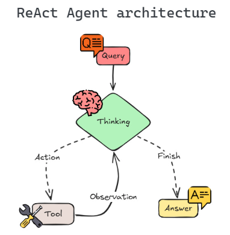
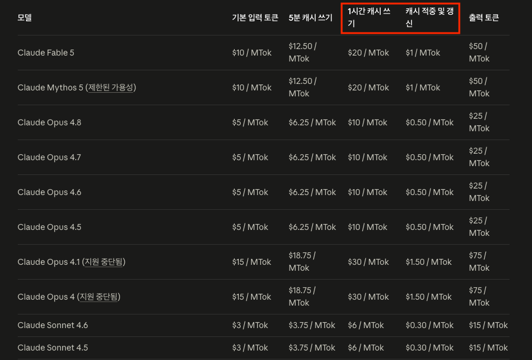
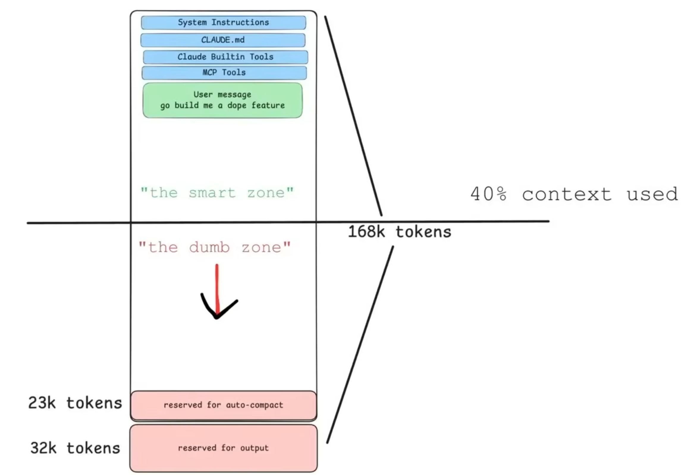
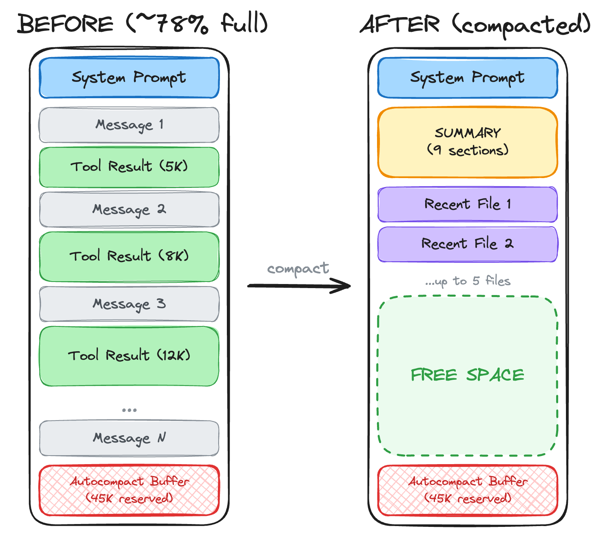
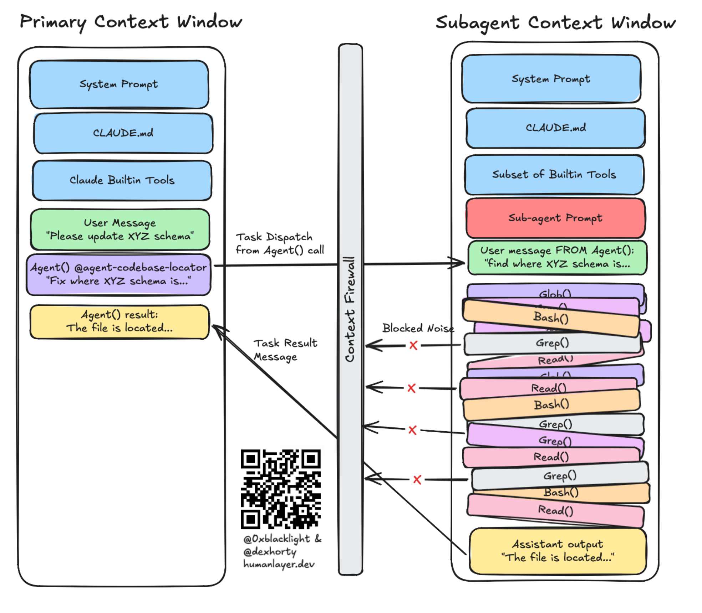
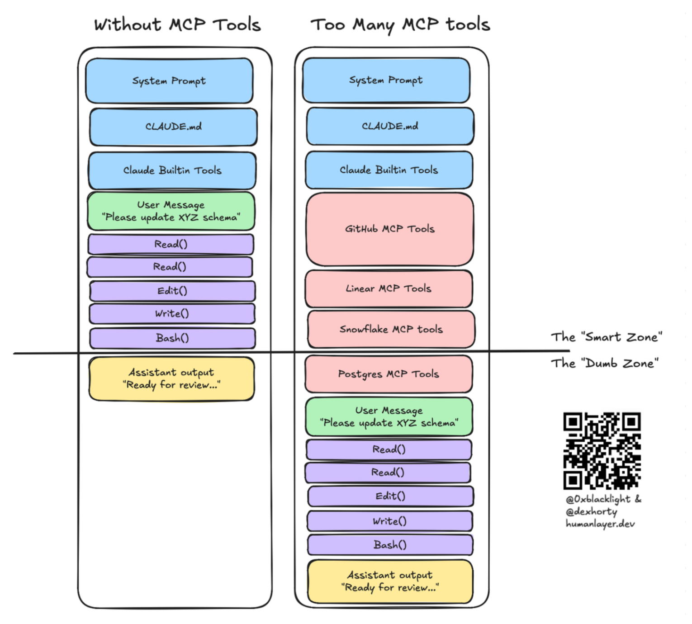
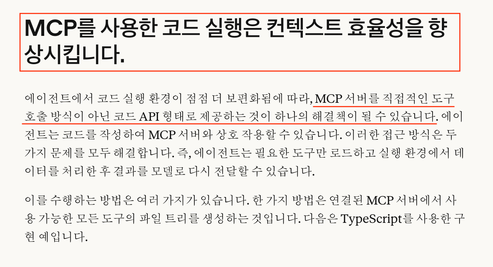
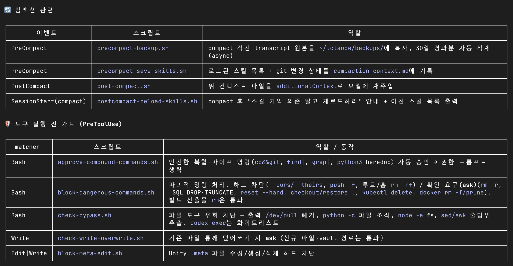

<!-- _class: title -->
<!-- _paginate: false -->

# Harness Engineering

KineticKeeper, 2026.06

---

# Before we start

- This talk is about agent harnesses like Claude Code and Codex (not web chat)
- Based on the Claude Code CLI (terminal)
  - The Desktop app has almost the same features, but some steps may differ
- I use Claude Max x5 ($100) + GPT Pro ($200)
- You don't need to know everything in this talk. Use it as a reference.

---

# Contents

- What is Harness Engineering ?
- AI Agent Principles
- Context Management Strategy
- Deterministic Control
- My Workflow
- Make It AI-Friendly
- Conclusion

---

# What is Harness Engineering ?

- Harness = leash = a tool that steers an agent to act the way you intend
  - Claude Code, Codex, Antigravity = CLI, TUI, IDE, APP ... they're all just harnesses.
  - Probabilistic steering (prompt, context, skills ...) + deterministic control (sandbox, hook, permission, tool, structured output ...)
  - Probabilistic steering: sometimes ignored, results vary / Deterministic control: enforced
- Harness engineering = the practice of keeping an agent on the path you intend
  - System Prompt, MCP, Hook, Skill ... = touch any of these and you're doing harness engineering.
- It's not a new idea. It's a new name for things we already know.
- The same model behaves differently depending on the harness and its version. (The system prompts differ)
  - Claude Code Opus != Antigravity Opus != JetBrains Rider Opus
  - [System Prompts Leaks](https://github.com/asgeirtj/system_prompts_leaks)
- [Steering Claude Code: CLAUDE.md files, skills, hooks, rules, subagents and more](https://claude.com/blog/steering-claude-code-skills-hooks-rules-subagents-and-more)

---

<!-- _class: title -->

# AI Agent Principles

---

# ReAct Loop (Reasoning and Acting)

**Thinking → Action → Observation → repeat**

- **Thinking**: What should I do now? (think)
  - If there's nothing left to do, answer
- **Action**: call a tool (act)
- **Observation**: check the result (observe)

> As the loop runs, observations **pile up in the context**

---

# Context Window

- LLMs are **stateless** = they have no memory. They only look like they remember.
- Every request **rebuilds the whole conversation so far** and sends it again
  - System prompt + tool definitions + files + full chat history
  - Every time I send a message, it rereads the session from start to finish
- Context window = short-term memory capacity = the bigger it is, the longer you can talk and work.
  - Sonnet (200k) vs Sonnet (1M Context)
  - Opus 4.8 (1M Context)
- Optimizing the context window -> feels a lot like optimizing memory

---

# Prompt Caching

- Everything that piles up is **resent on every request = billed every time**
  - Longer conversations use more tokens.
- **Prompt caching** -> caches recently used content to cut costs.
- If the beginning (**prefix**) is the same, it's reused → **cheaper and faster**
  - System prompt, tool definitions = the parts that rarely change
- Cache hit rate ↑ = cost ↓, speed ↑

---

---

# Cache Miss

- **If the prefix changes, everything from that point on breaks**
  - Changing the system prompt or tool definitions
  - Editing past messages, /rewind
  - Time passing (TTL): 1h by default / 5m depending on settings
- For work you'll pick up tomorrow, write a summary doc and continue in a new session
  - Example: fill 40% of the context today and just go home -> continue the chat tomorrow and it's a disaster (40% cache miss)

---

# Smart Zone & Dumb Zone

- Smart Zone: early in an AI session, when context usage is still at a healthy level.
- Dumb Zone: the conversation gets long, so much context piles up that attention hits its limit.
- Where Smart <-> Dumb flips can feel different by model and harness. You have to get a feel for it yourself

---

<!-- _class: title -->

# Context Management Strategy

---

# Why manage context?

- Use lots of tokens -> good results **(X)**: stuffing in more information doesn't make it smarter

- Good results -> use lots of tokens **(O)**: you need enough information to get good results

- Context = information, and context use => directly drives token usage

- Using more tokens means paying more money

- Managing context efficiently is how you cut token waste

> Cut the waste and **spend tokens where they matter**

---

# /compact

- The context window isn't infinite: once context fills past a certain level -> it gets compressed
  - **Kept**: the big picture, decisions, progress
  - **Lost**: exact code, specific numbers, fine nuance, original file text
  - Auto compact usually kicks in around 80%. (Depends on settings)
- Longer conversations use more context -> more tokens
- `/compact [summary instructions]` lets you compress the context whenever you want.
  - Around 40% context usage (Smart Zone vs Dumb Zone)
  - When you want to keep the working context but a cache miss is likely (meetings, end of day)

---

---

# CLAUDE.md

- `CLAUDE.md` = loaded by default at session start.
- Write down the instructions Claude should follow, habits to nudge, recommendations, and useful reference info.
  - `~/.claude/CLAUDE.md` : global
  - `{project path}/CLAUDE.md` : project
  - `{project path}/CLAUDE.local.md` : project, per user
- `/init` can write a first CLAUDE.md, but writing it yourself is more efficient and more useful
- Keep CLAUDE.md as short as possible.
  - Every request **rebuilds the whole conversation so far** and sends it again
    = `CLAUDE.md` is the constitution, so it's always loaded
    = `CLAUDE.md` is sent again on every request
- **Only what always applies + what matters goes in CLAUDE.md** → partial or domain rules go in `.claude/rules/`, split out by condition

---

# MEMORY.md

- `~/.claude/projects/{project path}/memory/MEMORY.md`
- `MEMORY.md` = **long-term memory that persists across sessions**
  - Context evaporates when a session ends -> the new session starts clueless -> save what this session learned to a file and pass it on to the next one
  - Record Claude's `mistakes, fixes, lessons, newly learned facts` so it does better next session
  - Only the **index** (one-line summaries) is always loaded -> individual files load only when relevant -> saves tokens, pull out only what you need
- Clean up the memories that keep piling up as you work
  - Remove what's no longer needed.
  - Summarize what can be compressed further.
  - Promote anything that belongs in `CLAUDE.md` or `.claude/rules/`.

---

# Subagent

- A subagent has its own context, isolated from the main agent.
  - Main agent: writes the instructions -> hands them to the subagent
  - Subagent: does the work, summarizes the result -> hands it back to the main agent
- Throwing subagents at everything can actually lower accuracy and add overhead.

---

---

# MCP

- Upside: it's a shared protocol, not tied to any one harness
  - Where there's no shell, MCP is almost the only option
  - One MCP server -> many clients can connect at once (good for deployment and portability)
- As MCP usage grows, watch for two common patterns that drive up token costs
  - Tool definitions can overload the context window. (Lazy loading helps)
  - Passing tool results back and forth burns tokens.

---

# CLI + Skill

- Where a shell is available, CLI + Skill can be cheaper than connecting MCP directly
  - Compress and filter the output -> get only what you need -> save tokens
  - If there's an auth flow like OAuth, you have to handle it yourself
- [Code execution with MCP: Building more efficient agents](https://www.anthropic.com/engineering/code-execution-with-mcp)

---

# Managing context mid-conversation

- `/btw` : ask a side question **without polluting** the context
  - The Q&A doesn't go into history -> no distracting extra context
- **Branch / switch**: split work off without weighing down the main context
  - `/fork` : hand off to a **background subagent** that inherits the current conversation, I stay in main -> collect only the result
  - `/branch` : **I** move into a copy of the session (the original is kept)
  - `/resume` : switch to a saved session / go back to the original
- `/rewind` (= Esc Esc) : roll back to a specific point / summarize a range
  - Restore code+conversation / conversation only / code only, or compress **just the selected range** ( `/compact` = everything)
  - Note: restore only covers files Claude edited (files changed by bash are outside the checkpoints)

---

# /context

- Type `/context all` to see the details.

<pre class="term" data-title="claude: ~/DEV"><i class=o> ▐▛███▜▌ </i>  <b>Claude Code</b> <i>v2.1.152</i>
<i class=o>▝▜█████▛▘</i>  <i>Opus 4.7 (1M context) with max effort | Claude Max</i>
<i class=o>  ▘▘ ▝▝  </i>  <i>~/DEV</i>

<b>❯ /context</b>
  ⎿  <b>Context Usage</b>
     <i class=c1>●</i> <i class=c2>●</i> <i class=c3>●</i> <i class=c4>●</i> <i class=c5>●</i> <i class=c6>●</i> □ □ □ □ □ □ □ □ □ □ □ □ □ □    <b>Opus 4.7 (1M context)</b>
     □ □ □ □ □ □ □ □ □ □ □ □ □ □ □ □ □ □ □ □    <i>claude-opus-4-7[1m]</i>
     □ □ □ □ □ □ □ □ □ □ □ □ □ □ □ □ □ □ □ □    <i>17.3k/1m tokens (2%)</i>
     □ □ □ □ □ □ □ □ □ □ □ □ □ □ □ □ □ □ □ □    
     □ □ □ □ □ □ □ □ □ □ □ □ □ □ □ □ □ □ □ □    <em>Estimated usage by category</em>
     □ □ □ □ □ □ □ □ □ □ □ □ □ □ □ □ □ □ □ □    <i class=c1>●</i> <b>System prompt:</b> 2.3k tokens (0.2%)
     □ □ □ □ □ □ □ □ □ □ □ □ □ □ □ □ □ □ □ □    <i class=c2>●</i> <b>System tools:</b> 6.6k tokens (0.7%)
     □ □ □ □ □ □ □ □ □ □ □ □ □ □ □ □ □ □ □ □    <i class=c3>●</i> <b>Custom agents:</b> 494 tokens (0.0%)
     □ □ □ □ □ □ □ □ □ □ □ □ □ □ □ □ □ □ □ □    <i class=c4>●</i> <b>Memory files:</b> 5k tokens (0.5%)
     □ □ □ □ □ □ □ □ □ □ □ □ □ □ □ □ □ □ □ □    <i class=c5>●</i> <b>Skills:</b> 2.8k tokens (0.3%)
                                                <i class=c6>●</i> <b>Messages:</b> 41 tokens (0.0%)
                                                □ <b>Free space:</b> 982.7k (98.3%)
     <b>Custom agents</b> <i>| /agents</i>      <b>Memory files</b> <i>| /memory</i>      <b>Skills</b> <i>| /skills</i>
     <i>└ 5 agents | 494 tokens</i>   <i>└ 3 files | 5k tokens</i>      <i>└ 40 skills | 2.8k tokens</i>

     <i>/context all to expand</i></pre>

---

<!-- _class: title -->

# Deterministic Control

---

# permission / sandbox

- Probabilistic steering **can sometimes be ignored** -> anything that must never be broken gets **enforced deterministically**
- **permission**: control tool calls with `allow / ask / deny`
  - 'Don't delete files' = a request
  - `rm -rf` deny = enforced
- **sandbox**: isolates **what a command can touch** at the OS level
  - Writes limited to the working folder, network limited to allowed domains -> even if something goes wrong, the damage stays contained
- **bypass and sandbox are separate layers**: even if bypass turns off every prompt, the OS still enforces the sandbox boundary
  - If you always run with `--dangerously-skip-permissions` -> **the sandbox is your only safety net**

---

# hooks

- Run **your own scripts deterministically** at specific points (before/after tool calls, session start, before commit, etc.)
- [Claude Code Docs - Hook lifecycle](https://code.claude.com/docs/en/hooks#hook-lifecycle)
- Example: return a failure when a Unity .meta edit is attempted
  - 'Don't edit .meta' = a request
  - Returning a failure on `.meta` edits with `PreToolUse` = enforced

<pre class="term" data-title="claude: ~/dev/my-game"><i class=hl>❯ ~/dev/my-game/Assets/Game/Common/Resources/dummy.txt.meta

  Change the GUID to 0</i>
<i>Read <b>1</b> file</i>

<i class=r>●</i> <b>Update</b>(my-game/Assets/Game/Common/Resources/dummy.txt.meta)
  ⎿  <i class=r>Error: PreToolUse:Edit hook error: ["$HOME/.claude/hooks/block-meta-edit.sh"]: No stderr output</i>

● The <i class=l>.meta</i> edit was blocked. The blocking hook <i class=l>~/.claude/hooks/block-meta-edit.sh</i> stopped it (enforcing the "no manual .meta edits" rule in CLAUDE.md).</pre>

---

# hooks

---

<!-- _class: title -->

# My Workflow

---

# Correcting AI behavior with CLAUDE.md

- Tame the model's recurring weaknesses to fit your style
  - **Curb hallucination**: no guessing (no claims without code evidence), state confidence %
  - **Curb sycophancy**: don't flip positions (no flattery), no excuses for mistakes -> propose a fix
  - **Curb overengineering**: keep code simple. Could it be half the size? Is it overdone?
  - **Output rules**: inverted pyramid (conclusion -> evidence)
- Write down project rules that are hard to learn from the code, and set guidelines
  - **Basics**: Unity project 2021.3.57f2, IL2CPP, define symbols
  - **Design principles**: watch GC, code philosophy
  - **Task checklist**: no manual `.meta` edits, stay within the requested scope
  - **Verification**: compile check `dotnet build | grep "error CS"` -> **after writing code, it compiles and catches its own errors**

---

# The Socratic method

- An LLM is a language model = you have to put your requirements into words
  - If I leave something out because it seems obvious to me, the AI guesses = miscommunication
  - Sometimes I don't really know what I want either
- Socratic method = make the AI ask first = `Why do you think so?`
  - Contradictory or unclear requests get confirmed = prevents miscommunication
  - Vague ideas in my head turn into clear sentences = a clearer spec
  - **Keep digging through interviews until the required conditions are met, then lock the spec**
- Already widely used in popular open source projects
  - Never install the originals as is. Analyze them and adopt only the concepts you need -> keep the harness as light as possible
  - `superpowers` / `grill-me` / `ouroboros` ... install everything that looks good and you get conflicts and a token explosion
  - Steal only the concepts you need and customize them for yourself

---

# Spec -> Design -> Plan

- Instead of Claude Code's built-in Plan Mode: spec-driven development (SDD = Spec Driven Development)
  - Pays off on reasonably large tasks (overkill for a simple bug fix)
- Gather enough context through conversation and exploration -> interview on decisions -> once the conditions are met, write the specs -> review, then revise / proceed
  - spec : What's the feature? Details? Constraints? Done criteria? -> `SPEC-xxx.md` (optional)
  - design : Is it feasible? How? Technical decisions? -> `DESIGN-xxx.md` (optional)
  - plan : How many tasks? Which files change? Expected results? How to verify? -> `PLAN-xxx.md`
- Run the plan in a new session or hand it to another agent. (Smart Zone & Dumb Zone)

---

# Code Review

- `/simplify` , `/code-review` : Claude Code's built-in commands for cleaning up and reviewing code
  - Review in a new session or through a subagent, not in the session that did the work. (A clean context avoids bias)
  - Subagent reviews the code -> main agent **double-checks** the findings -> reports
  - Define review agents around the traits of Unity and InGame code, and pair them with skills to hunt for edge cases
- `ultracode` + `dynamic workflows`
  - **Define** a multi-step pipeline **yourself**, split the work into areas, and run many agents in parallel.
  - Use cases: large jobs that don't fit in one context, cross-review of critical issues, in-depth research ( `/deep-research` )
- AI code review is a supporting tool. Check the findings yourself and verify them by hand

---

# Context Gathering Skills

- Sometimes explaining things to the AI is the bottleneck
  - `atlassian-page-cli` : Confluence or Jira URL -> passes along the original text plus attached screenshots and videos, so you explain less
  - `backtrace-tracker` : crash info -> automatic Backtrace lookup -> finds similar issues -> loads them into the AI's context
  - `reading-bytes-tables` : looks up design table values (not in the code) -> the AI reads them and judges the logic itself
- `LLM Wiki` : the LLM manages the information it can reference on its own. Clear links between docs, MOC tags

---

<!-- _class: title -->

# Make It AI-Friendly

---

# Give it enough context

- Did you give Claude enough information?
  - Don't just give orders. Give it the right context first
  - Writing good prompts = trying to give good context
  - If writing prompts is a chore, give it guidelines, methods, and tools to gather context on its own
- The AI is a genius new hire who doesn't know our project
  - Huge files, misleading variable names, spaghetti code -> it gets confused.
  - Domain rules and tacit knowledge the code doesn't answer -> it doesn't know.

---

# Give it readable code

- Code is the biggest pool of context Claude can reach
  - Our code conventions = the textbook Claude copies from
- Make roles obvious from class and function names -> avoids Grep and Read confusion.
- Remove unnecessary comments -> avoids Grep and Read confusion.
- Split files that run tens of thousands of lines by role as much as you can -> optimizes token usage.
- Code that's clean for humans = usually better for AI too.

---

# Let it learn the domain

- Tacit knowledge that's hard to get from code is the main cause of wrong guesses (protocols, conventions, agreements)
  - How did we agree to handle this protocol/resource with the server team/art team?
  - Which classes and functions did we agree to use in which situations?
  - Are there team rules or notes shared through outside channels like chat or Confluence?
- Write down the gotchas in `.claude/rules/*.md`
  - `paths` : the rules doc loads into context when those files are accessed. (Conditional loading)
  - Commit it to Git and every teammate's AI gets it

---

<!-- The original PDF is missing one slide right before this one (originally page 38). The original page numbers jump from 37 to 39. -->

# Give it a way to verify

- Without a way to verify, the AI decides however it likes.
- With one, the loop closes: detect -> fix -> verify again
  - It provides the Observation step of the `ReAct Loop`
- Ways to verify
  - Compile (dotnet build), static analysis: the cheapest and simplest
  - Unit tests: some codebases make them hard to adopt
  - Automated runtime tests: token and time costs / R&D cost to make them efficient
  - Human in the loop + feedback: realistic and highly reliable. The human becomes the bottleneck

---

<!-- _class: title -->

# Conclusion

---

# Harness engineering -> verify -> improve -> repeat

- **Verify**: check that the harness runs as intended. It's probabilistic, so don't trust it, verify it.
- **Improve, repeat**: even a finished harness changes when a new model ships -> a loop that never ends
  - [Opus 4.7 best practices](https://claude.com/blog/best-practices-for-using-claude-opus-4-7-with-claude-code)
  - [Opus 4.8 prompting](https://platform.claude.com/docs/en/build-with-claude/prompt-engineering/prompting-claude-opus-4-8)

> Design an environment where the AI can produce good results, and keep maintaining it

---

<!-- _class: title -->

# END
