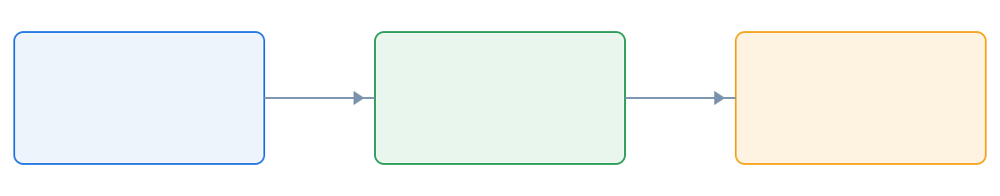

<!-- _class: title -->
<!-- _paginate: false -->

# 정적 사이트 안의 발표 자료

## 마크다운으로 적고, 빌드 때 그림으로 만든다

초안이다. 공개 목록에는 올리지 않는다.

---

###### 문제

# 세로 화면 — 1280 캔버스를 통째로 줄이면 본문이 사라진다

발표 자료는 16:9 한 장이다. 휴대전화 너비에 맞추면 본문 23px가 한 자리 수로 줄어든다.

- **화면 높이** 주소창이 들락날락하면 `100vh` 슬라이드가 잘린다
- **조작** 이전, 다음, 쪽수, 전체 화면이 한 줄에 남아야 한다
- **넘기기** 스와이프와 좌우 탭이 없고 버튼만 있으면 한 손으로 못 넘긴다
- **전체 화면** iPhone은 Fullscreen API가 거절되면 아무 일도 없다
- **글자** 슬라이드 문단을 다시 흘려 적지 않는다. 핀치로 키우거나 가로로 돌린다
- **주변** 사이트의 헤더와 언어 버튼이 슬라이드 위를 덮으면 안 된다

---

###### 비교표

# 보기 방식 — 같은 덱을 어디에 그리느냐

본문은 테마의 23px를 유지한다. 칸을 늘려도 문단을 재배치하지 않는다.

| 보기 | 캔버스 | 본문 | 조작 | 쓸 때 |
| --- | --- | --- | --- | --- |
| 스크롤 | 너비 100% | 작다 | 위 막대 | 세로로 훑을 때 |
| 한 장 | 16:9 | 화면을 따른다 | 탭하면 나타난다 | 가로로 볼 때 |
| 전체 화면 | 뷰포트 | 한 장과 같다 | 같은 막대 | 발표할 때 |
| 핀치 | 브라우저 배율 | 커진다 | 두 손가락 | 세로에서 읽을 때 |
| 초안 | 빌드에서 제외 | 같다 | 로컬만 | 확인용 |
| 공개 | 목록에 포함 | 같다 | 사이트 안 | 발표 후 |

- 표의 글자도 본문과 같은 비율이다. 따로 키우지 않는다

---

###### 구성

# 덱 한 벌 — 파일은 네 종류면 된다

  

마크다운

슬라이드를 --- 로 나눈다

  

테마

presentation 한 파일

  

그림

img/ 상대 경로

  

초안

draft 면 목록 제외

frontmatter에 제목, 날짜, 설명, 언어를 적는다. 스타일 블록은 덱 안에 넣지 않는다.

---

###### 그림

# 상대 경로 — 빌드가 공개 주소로 바꾼다

- SVG는 그대로 복사한다
- PNG와 JPEG는 WebP로 바꾼다
- 현재 장이 아닌 그림은 늦게 읽는다

---

<!-- _class: divider -->

# 한 장씩

## 가로로 돌리면 슬라이드가 화면을 채운다

---

###### 가로 / 세로

# 두 칸 — 세로로 훑기와 한 장씩 넘기기

  

    

스크롤

    
세로 휴대전화의 기본이다. 슬라이드를 너비에 맞춰 쌓는다. 한 장을 누르면 그 장으로 한 장씩 보기가 열린다. 아직 세로면 휴대폰을 가로로 돌리라는 안내가 붙는다.

  

  

    

한 장

    
가로이거나 넓은 화면의 기본이다. 헤더와 제목 줄을 치우고 16:9가 뷰포트를 채운다. 조작 막대는 반투명이고, 탭하기 전에는 숨긴다.

  

---

###### 정리

# 확인할 것 — 빌드 결과만 보면 된다

1. **쪽수** 주소의 `#N`이 그 장을 연다
2. **언어** 영어 목록에는 한국어 덱이 없다
3. **초안** 프로덕션 빌드는 이 덱을 빼 둔다
4. **그림** 상대 경로가 공개 경로로 바뀐다
5. **글자** 본문은 테마 크기 그대로다
6. **조작** 버튼은 44px이고 360px 너비에 들어간다

> 이 상자는 자리만 표시한다. 재배치하지 않는다.

---

<!-- _class: title -->
<!-- _paginate: false -->

# 질문

## 샘플은 여기까지다
